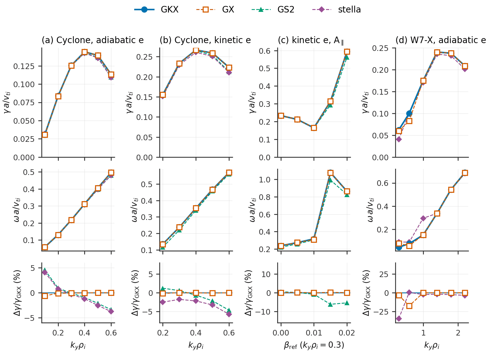
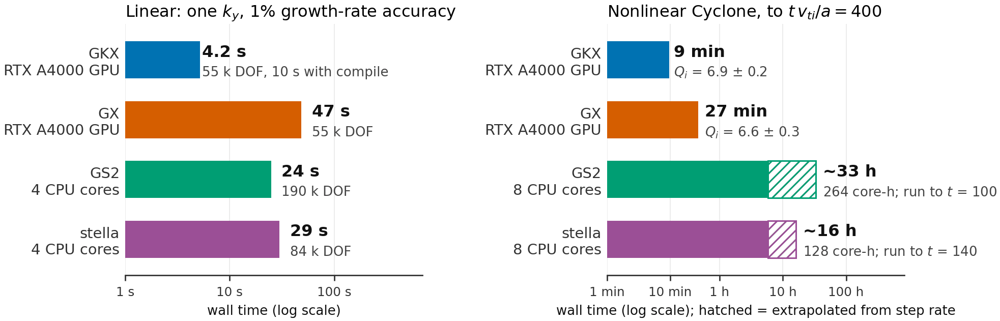
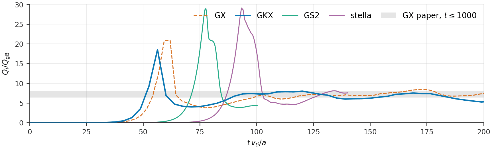
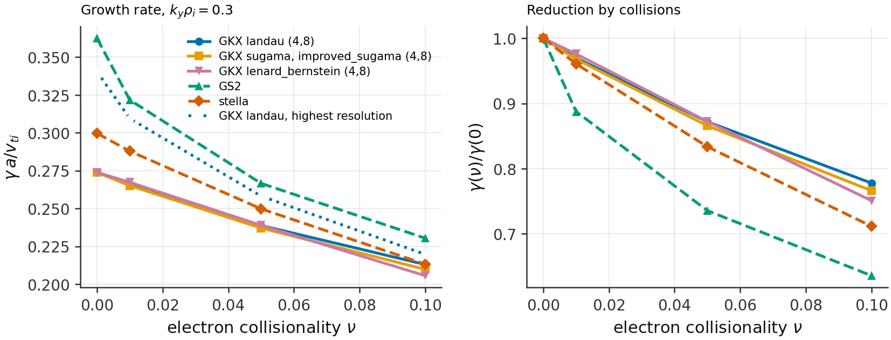
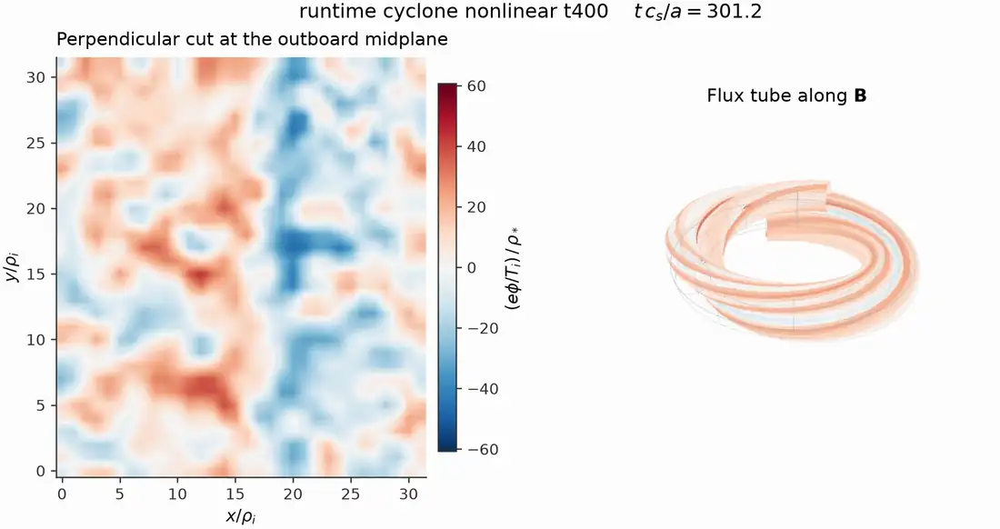

# GKX

[](https://github.com/uwplasma/GKX/releases)
[](https://pypi.org/project/gkx/)
[](https://github.com/uwplasma/GKX/actions/workflows/ci.yml)
[](https://codecov.io/gh/uwplasma/GKX)
[](LICENSE)
[](pyproject.toml)
[](https://gkx.readthedocs.io)

GKX is a JAX gyrokinetic solver for tokamak and stellarator flux tubes. It
reads a VMEC or VMEX equilibrium, or builds an analytic Miller or s-alpha
geometry, and computes linear stability and nonlinear turbulence in a
Hermite-Laguerre velocity basis. The whole path, equilibrium included, is
differentiable on CPUs and GPUs.

**Comparison across gyrokinetic codes**







GKX, GX, GS2 and stella solve the same Cyclone and W7-X flux-tube problems in
GX units: linear growth rate and frequency, wall time, and the nonlinear
Cyclone heat flux. Redraw the figures with
`python docs/figures/four_code_comparison.py`, which reads
`docs/figures/four_code_comparison.json`. The GKX runs use the decks in
`benchmarks/cases`; the GX, GS2 and stella runs need those codes installed.
Resolutions, hardware and caveats are in the
[validation guide](docs/validation.rst).

## Install and first run

```bash
pip install gkx
gkx
```

Python 3.10+. The wheel installs CPU JAX; for GPUs add an accelerator JAX wheel
([JAX install guide](https://docs.jax.dev/en/latest/installation.html)).
`gkx` with no arguments runs a linear Cyclone case and prints its growth rate
`gamma` and real frequency `omega`. The [tutorial](docs/tutorials.rst) walks
through the runs in [examples/](examples), from this one to a stellarator
optimization.

## Run a case

```bash
gkx wout_circular_tokamak.nc --estimate   # size the grid, explain it, exit
gkx wout_circular_tokamak.nc              # nonlinear ITG run to saturation
gkx plot wout_circular_tokamak/gkx.out.nc # replot a saved bundle
gkx examples/01_linear_tokamak/case.toml  # any TOML deck
```

A run stops when heat flux, field energy and free energy are stationary, or
reports that it did not. It writes figures, a restartable NetCDF bundle and the
resolved deck that reproduces it.

```python
import gkx

case = gkx.load("examples/01_linear_tokamak/case.toml")
result = gkx.solve(case, ky_target=0.3, Nl=case.run.Nl, Nm=case.run.Nm)
print(result.gamma, result.omega)
```

Every deck key, with type and default, is listed in [inputs](docs/inputs.rst);
[examples/reference_inputs](examples/reference_inputs) holds decks that set
every key at its default.

## Defaults

| Choice | Default |
|---|---|
| Velocity space | Hermite-Laguerre `(Nl, Nm)`; kinetic electrons get per-species counts |
| Collisions | linearized Landau |
| Nonlinear stepper | `auto`: `lawson-rk4-pi` or `rk4-pi`; `imex-ark3` for kinetic electrons at beta <= 3e-4 |
| Linear solver | `auto`: time integration, then the certified eigensolver (banded shift-invert, else Arnoldi); `krylov` runs the eigensolver directly |
| End damping | one rate on every route, 30 thermal transits across the end layer |
| `ky` layout | `half`, the non-negative rows |
| Precision | `float32`; `JAX_ENABLE_X64=true` for `float64` |

[Guidance](docs/guidance.rst) says what to set for kinetic electrons and
electromagnetic runs, and how to check it.

## Collision operators

`collision_operator` in `[time]` selects the model; `nu` sets the collision
frequency for all of them ([operators](docs/operators.rst)).

- `landau` (default): the linearized Landau operator, exact in the drift-kinetic limit. Use it unless a comparison calls for another model.
- `sugama`: Landau test part with momentum- and energy-restoring field part, self-adjoint between unlike species and temperatures. Use it to compare with codes that use this model.
- `improved_sugama`: `sugama` with the exact Landau heat-flux and friction terms; it tracks `landau` at high collisionality.
- `lenard_bernstein`: conserving Lenard-Bernstein/Dougherty relaxation, the cheapest model. It captures collisional damping qualitatively, not the Landau operator.
- `coulomb_finite_kperp`: tabulated gyrokinetic Coulomb operator with finite k_perp, for one species.



Collisional trapped-electron mode at k_y rho_i = 0.3 on the
`benchmarks/cases/tem_collisional.toml` deck. At (Nl, Nm) = (4, 8) the four
operators lie within 4% of one another; GKX is not converged there. Redraw with
`python docs/figures/collision_operators.py`.

## Derivatives and optimization

Eigenvalue derivatives use `dλ/dp = wᴴ(dA/dp)v / (wᴴv)` with residual, overlap
and conditioning checks. Nonlinear heat-flux derivatives use a checkpointed
discrete adjoint over a finite post-saturation window. Compare these
derivatives with finite differences across perturbation sizes and window
lengths; assess a design change with independent long simulations
([nonlinear autodiff](docs/nonlinear_autodiff.rst)).

[VMEX](https://github.com/uwplasma/vmex) composes its equilibrium derivative
with GKX objectives in stellarator shape optimization; the
[optimization example](examples/10_vmex_optimization/run.py) combines heat flux
with equilibrium constraints. Quasilinear flux requires calibration and
held-out nonlinear validation before it supports an absolute transport
prediction ([quasilinear](docs/quasilinear.rst),
[stellarator optimization](docs/stellarator_optimization.rst)).



Saturated ITG turbulence on a Cyclone flux tube
([full-rate movie](https://github.com/uwplasma/GKX/releases/download/v1.7.0/gkx-cyclone-itg-turbulence.mp4)).

## Documentation and development

Documentation: **[gkx.readthedocs.io](https://gkx.readthedocs.io)**. Start with
the [tutorial](docs/tutorials.rst) and the [guidance](docs/guidance.rst);
validation and cross-code protocols are in [validation](docs/validation.rst),
performance and parallel execution in [performance](docs/performance.rst) and
[parallelization](docs/parallelization.rst).

```bash
git clone https://github.com/uwplasma/GKX
cd GKX
pip install -e ".[dev]"
pytest -n 4
```

CI requires 95% line coverage plus the physics, convergence, comparison,
differentiability and performance gates ([CONTRIBUTING.md](CONTRIBUTING.md)).
Cite GKX with [CITATION.cff](CITATION.cff). MIT license; see [LICENSE](LICENSE).
