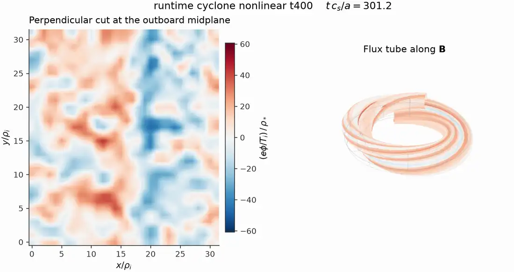
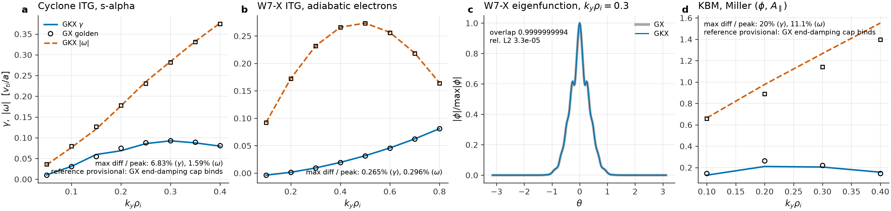
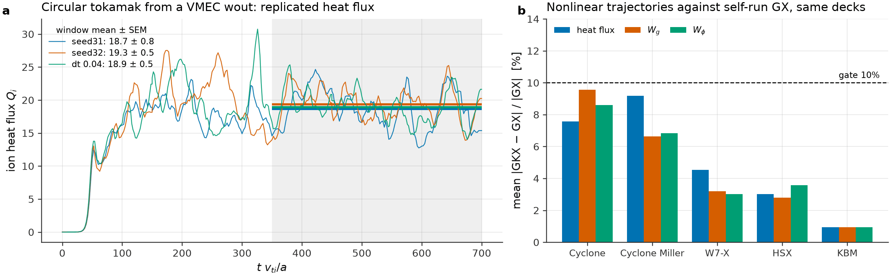
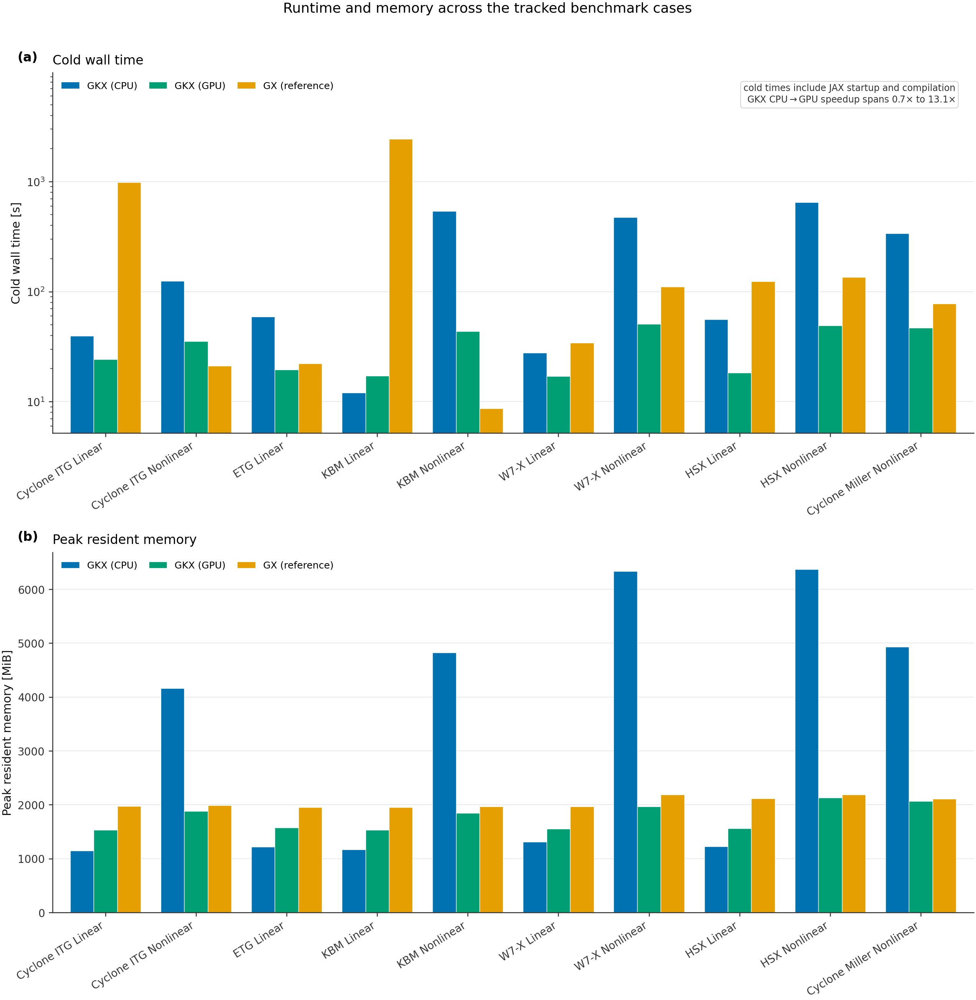
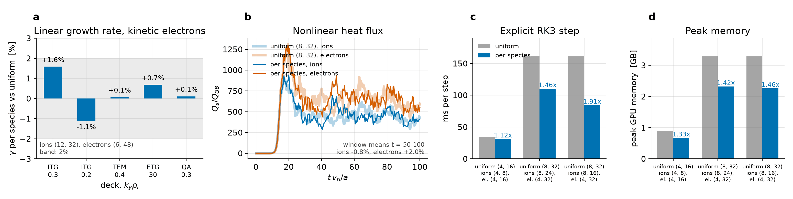

# GKX

[](https://github.com/uwplasma/GKX/releases)
[](https://pypi.org/project/gkx/)
[](https://github.com/uwplasma/GKX/actions/workflows/ci.yml)
[](https://codecov.io/gh/uwplasma/GKX)
[](LICENSE)
[](pyproject.toml)
[](https://gkx.readthedocs.io)

GKX is a JAX gyrokinetic solver for tokamak and stellarator flux tubes. It
reads a VMEC or VMEX equilibrium, or builds an analytic Miller or s-alpha
geometry, and computes linear stability and nonlinear turbulence in a
Hermite-Laguerre velocity basis. The whole path, equilibrium included, is
differentiable on CPUs and GPUs.

- **Run what you have:** a VMEC/VMEX `wout`, a Miller or s-alpha tokamak, or
  one TOML deck. The executable sizes the grid and says why.
- **Trust the eigenvalue:** every returned eigenpair is checked against the
  full operator; an under-resolved run warns instead of reporting a number.
- **Differentiate it:** implicit eigenvalue derivatives, and a checkpointed
  adjoint of the nonlinear heat flux over a saturated window.
- **Optimize with it:** the heat flux, growth rate or quasilinear flux is an
  objective in VMEX stellarator shape optimization.



Saturated ITG turbulence on a Cyclone flux tube
([full-rate movie](https://github.com/uwplasma/GKX/releases/download/v1.7.0/gkx-cyclone-itg-turbulence.mp4)).

## New in 2.8

- **Per-species velocity resolution:** ions and electrons keep their own
  `(Nl, Nm)`, so ions no longer pay for the electrons' Hermite moments.
  Kinetic-electron decks that name no resolution get converged per-species
  counts; explicit steps are up to 1.9x faster in 1.5x less memory.
- **Implicit collisions when needed:** at high electron collisionality the
  IMEX steps take the Landau operator implicitly, where the explicit step
  goes non-finite; low-collisionality runs are unchanged.
- **Reflectionless Hermite closure (opt-in):** `[[species]] hermite_closure`
  absorbs the last Hermite moment instead of damping it.
- **Safer adaptive steps:** a deck with `dt` and `fixed_dt = false` uses the
  controller's stepper, not `rk2`, which blew up on kinetic-electron decks.
- **Python 3.10** is supported again.
- Also: a nodal `mu` grid for linear runs, faster electromagnetic brackets and
  RK4 stages, and a NaN fix in high-resolution Landau tables.

## Install and first run

```bash
pip install gkx
gkx
```

Python 3.10+. The wheel installs CPU JAX; for GPUs add an accelerator JAX wheel
([JAX install guide](https://docs.jax.dev/en/latest/installation.html)).
`gkx` with no arguments runs a linear Cyclone case in under a minute on a
laptop CPU and prints `gamma` and `omega`; a CI gate holds its growth rate
within 1% of the certified eigenvalue. The [tutorial](docs/tutorials.rst) walks
through twelve runs, from this one to a stellarator optimization; each is a
directory in [examples/](examples/).

## Run a case

```bash
gkx wout_circular_tokamak.nc --estimate   # size the grid, explain it, exit
gkx wout_circular_tokamak.nc              # nonlinear ITG run to saturation
gkx plot wout_circular_tokamak/gkx.out.nc # replot a saved bundle
gkx examples/01_linear_tokamak/case.toml  # any TOML deck
```

`--estimate` derives each grid entry from the geometry and prints the reason. A
run stops when heat flux, field energy and free energy are stationary, or
reports that it did not. It writes figures, a restartable NetCDF bundle and the
resolved deck that reproduces it ([inputs](docs/inputs.rst),
[outputs](docs/outputs.rst)).

From Python:

```python
import gkx

case = gkx.load("examples/01_linear_tokamak/case.toml")
result = gkx.solve(
    case, ky_target=0.3, Nl=case.run.Nl, Nm=case.run.Nm, show_progress=True
)
print(result.gamma, result.omega)
```

## Linear stability



Growth rate and frequency scans for Cyclone ITG (a), W7-X ITG (b) and KBM (d),
and the W7-X eigenfunction at `ky rho_i = 0.3` (c), whose overlap with GX's is
0.9999999994.

- The default eigensolver (`auto`) is a banded direct shift-invert where it
  fits, else Arnoldi on the time-advance map. It returns an
  eigenpair only after checking it against the full operator. Matrix-free
  shift-invert is opt-in for a chosen branch ([policy and measurements](docs/algorithms.rst)).
- Under-resolved or unsettled fits warn instead of reporting a number.

## Models and defaults

| Choice | Default | Notes |
|---|---|---|
| Geometry | s-alpha, Miller, VMEC/VMEX, imported | `[geometry] model`; `gkx wout_*.nc` for any VMEC |
| Velocity space | Hermite-Laguerre, `(Nl, Nm)`, per species with `[[species]] Nl`/`Nm` | hypercollisions damp the last Hermite moments; kinetic-electron decks that name no resolution get ions (12, 32) and electrons (6, 48) linear, (4, 16) nonlinear ([guidance](docs/guidance.rst)) |
| Hermite closure (opt-in) | `[[species]] hermite_closure = "reflectionless"` | absorbing last-moment closure per species: TEM growth rate +4-11% at `Nm` 16, +1-2% at `Nm` >= 48; not the default ([numerics](docs/numerics.rst)) |
| Perpendicular velocity (opt-in) | nodal `mu` grid: `[run] mu_vperp_max = 4.0`, `Nl` = nodes | linear runs; 8 nodes match Laguerre `Nl` 16-24 on Cyclone at 5-12x less cost; flat convergence on TEM and KBM ([numerics](docs/numerics.rst)) |
| Collisions | linearized Landau | conserving, H-theorem; Dougherty, Sugama alternatives ([operators](docs/operators.rst)) |
| End damping | one rate, `[time] damp_ends_rate` | same on every route; no time step enters ([numerics](docs/numerics.rst)) |
| Time stepping | no `dt`: nonlinear `rk4-pi`, or adaptive `imex-ark3` for kinetic electrons at beta <= 3e-4; linear `rk4` + CFL | a `dt` gives `rk2` at that step; `fixed_dt = false` keeps the controller's stepper ([measured speedups](docs/guidance.rst)) |
| Eigensolver | `auto` (banded, else `adaptive`), certified | shift-invert opt-in |
| `ky` layout | `half`: the `1 + Ny//2` non-negative rows | `[grid] ky_layout = "full"` stores the two-sided axis; same physics to round-off, about 1.4-1.8x slower and 12-25% more memory |
| Precision | `float32`; `float64` with `JAX_ENABLE_X64=true` | eigensolver, Krylov residual and conditioning checks need `float64` |
| CPU threads | XLA's own; Eigen pool off on fewer than four CPUs | steps do not scale past about four threads ([performance](docs/performance.rst)) |

[Resolution, step and solver guidance](docs/guidance.rst) says what to set for
kinetic electrons and electromagnetic runs, and how to check it.

## Agreement with other codes

| Case | `gamma` | `omega` |
| --- | ---: | ---: |
| KAW | 0.0004% | 0.051% |
| ETG | 0.040% | 0.074% |
| W7-X | 0.265% | 0.296% |
| HSX | 0.577% | 0.273% |
| Cyclone Miller | 5.51% | 1.25% |
| Cyclone ITG | 6.83% | 1.59% |
| **KBM** | **20.0%** | **11.1%** |

`100 * max|GKX - ref| / max|ref|` over the tracked scan, recomputed by CI from
the [evidence ledger](tools/evidence_ledger.toml). The Cyclone rows compare a
time-trace fit, not the certified eigenvalue, and KBM is the known outlier: its
reference omits end damping on the top Hermite moments, a repaired GX run of
the deck agrees with GKX to 0.3% at `k_y` 0.2 and 0.3, and against GS2 the KBM
growth rate agrees to 5% (frequency 6%) once `ntheta` is resolved, against 19% at the
deck's `ntheta = 32`, where both codes are under-resolved.
Against GX's repaired launch limit the certified Cyclone eigenpairs agree to
0.3% in growth rate at seven of eight `k_y`; against converged GS2 GKX is
within 1.0% at the three `k_y` compared. These are agreements on shared test
cases, not a ranking of codes. Open items (TEM velocity convergence, stella's
mirror-term sensitivity, weakly growing modes) and the figures are in
[validation](docs/validation.rst).

## Nonlinear turbulence



(a) A circular tokamak run straight from a VMEC `wout`, replicated with two
seeds and a second time step: window means 18.7, 19.3 and 18.9 over
`t = 350-700`, a 3.5% spread against a 15% gate. (b) Mean relative difference
from GX runs of the same decks in heat flux, free energy and field energy for
Cyclone, Cyclone Miller, W7-X, HSX and KBM, all below 10%. This is a window
comparison, not a validation of saturated transport.

## Derivatives and optimization

Eigenvalue derivatives use `dλ/dp = wᴴ(dA/dp)v / (wᴴv)`. The nonlinear heat
flux over a post-saturation window is differentiated through a
block-checkpointed discrete adjoint
([figure](docs/_static/nonlinear_autodiff_validation.png)): on a 16x16x16
Cyclone case over 1024 steps, checkpointing cuts temporary memory from 7.8 GB to
187 MB for about twice the runtime, and the gradient matches finite differences
to 1e-11 through 512 steps.

```python
heat_flux, gradient = jax.value_and_grad(loss)(shape0)
```

[VMEX](https://github.com/uwplasma/vmex) composes its implicit equilibrium
derivative with GKX's, so a growth rate, quasilinear flux or nonlinear heat flux
sits next to quasisymmetry, aspect ratio and iota in one least-squares problem.
`examples/10_vmex_optimization/run.py` extends VMEX's `QA_optimization.py` with
the nonlinear heat flux as a fourth objective on the vacuum QA ladder ([equilibria](docs/_static/qa_transport_equilibria.png),
[traces](docs/_static/qa_transport_reduction.svg)).

The boundary change is small (aspect ratio +0.0115%, mean iota -0.044%). The
preliminary 12.26% reduction across 24 nominal pairs (conditional 95% CI
10.64-13.88%) is not statistically resolved: 4 of 48 nominal traces fail the
per-trace drift test. A transport claim needs matched, replicated, long
post-saturation windows. The quasilinear flux is a ranking and screening
measure, not a runtime/TOML absolute-flux predictor
([quasilinear](docs/quasilinear.rst),
[stellarator optimization](docs/stellarator_optimization.rst)).

## Performance



- **Nonlinear step:** about 196 ns per `Nx*Ny*Nz*Nl*Nm` element per step on CPU;
  15.6 ms for 64x64x24, Nl = 4, Nm = 8 on one RTX A4000.
- **Eigenvalues:** the sparse direct shift-invert route certifies the Cyclone
  eigenpair at n = 3,072 in about 5 s against 32-36 s matrix-free.
- **Kinetic electrons:** `imex-ars3` is 10x faster to solution than RK3 at
  64x64x24, and does not pay on tutorial grids. The adaptive `imex-ark3`
  default holds the error per step to 1e-3: its saturated heat flux averages within
  1% of `rk4-pi` (three seeds, 32x32x16) at about 2x the steps of 1e-2, which
  read 6% high ([guidance](docs/guidance.rst)).
- **Parallel work:** independent `k_y` scans and ensembles run across devices
  with results identical to the serial run.

Each species can keep its own `Nl` and `Nm`, so ions do not pay for the
electrons' Hermite moments. Against uniform counts the growth rate agrees to
1.6% on Cyclone ITG, TEM, ETG-range and QA stellarator decks and the nonlinear
heat-flux window mean to 2%; an explicit 64x64x24 step is 1.1-1.9x faster in
1.3-1.5x less memory. The implicit `imex` factor and collision sub-step also
run at each species' own counts: with ions (8, 16) and electrons (4, 32) the
32x32x16 factor is 3.3x smaller and a solve 2.2x faster, and 64x64x24 fits a
16 GB GPU where the padded factor does not ([guidance](docs/guidance.rst)).



[Performance](docs/performance.rst) · [parallelization](docs/parallelization.rst).

## Documentation and development

Documentation: **[gkx.readthedocs.io](https://gkx.readthedocs.io)**. Start with
the [tutorial](docs/tutorials.rst) and the [guidance page](docs/guidance.rst);
equations and algorithms are in [theory](docs/theory.rst),
[operators](docs/operators.rst) and [numerics](docs/numerics.rst); modules in
[design](docs/design.rst).

```bash
git clone https://github.com/uwplasma/GKX
cd GKX
pip install -e ".[dev]"
pytest -n 4
```

CI requires 95% line coverage plus the physics, convergence, comparison,
differentiability and performance gates ([CONTRIBUTING.md](CONTRIBUTING.md)).
Figures in `docs/_static/readme/` have JSON companions with every plotted
number; their generators were removed from `scripts/` and are listed in
`plan/log.md` (2026-10-15). Cite GKX with [CITATION.cff](CITATION.cff).

## License

MIT; see [LICENSE](LICENSE).
