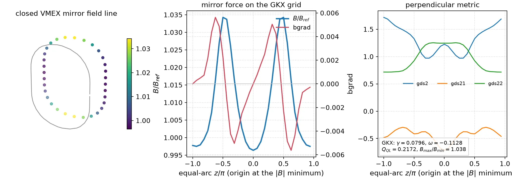

Geometry
========

S-alpha flux-tube model
-----------------------

The analytic s-alpha model (``geometry.model = "s-alpha"``, the default) is
the geometry of the Cyclone base case benchmarks. With the shear function
:math:`\sigma(\theta) = \hat{s}\,\theta - \alpha \sin\theta`, the field-aligned
radial wave number is

.. math::

   k_x(\theta) = k_{x0} - \sigma(\theta)\, k_y,

and the metric coefficients are

.. math::

   g_{ds2} = 1 + \sigma^2,\quad
   g_{ds21} = -\hat{s}\,\sigma,\quad
   g_{ds22} = \hat{s}^2 .

The solver writes the perpendicular wave number with the radial wave number
divided by the shear, :math:`\hat{k}_x = k_{x0}/\hat{s}`:

.. math::

   k_\perp^2(\theta) =
   \left[k_y \left(k_y g_{ds2} + 2 \hat{k}_x g_{ds21} \right)
   + \hat{k}_x^2 g_{ds22}\right] B^{-2}(\theta),
   \qquad
   B(\theta) = \frac{1}{1 + \epsilon \cos\theta},

so the factors of :math:`\hat{s}` cancel at finite shear. The :math:`B^{-2}`
factor is applied when ``kperp2_bmag = True`` (see :doc:`normalization`). At
exactly zero shear the solver uses :math:`\hat{k}_x = k_{x0}` and
:math:`g_{ds22} = 1`, so radial modes keep their finite-Larmor-radius
dependence. The same zero-shear contract applies to ``SlabGeometry``
(``gkx.geometry.analytic``).

The metric coefficients select the zero-shear branch with ``jnp.where`` on
``s_hat``, so they stay traceable: at finite shear, ``jax.grad`` and
``jax.jit(jax.grad(...))`` of the s-alpha and slab metric coefficients with
respect to ``s_hat`` agree with central finite differences
(``tests/unit/geometry/test_geometry.py``). Derivatives across the zero-shear
switch are not claimed.

Parameters
----------

The geometry is specified by:

- ``q``: safety factor
- ``s_hat``: magnetic shear
- ``epsilon``: inverse aspect ratio
- ``R0``: reference major radius
- ``B0``: reference magnetic field
- ``alpha``: pressure-gradient parameter in :math:`\sigma(\theta)`
- ``drift_scale``: drift normalization (``1.0`` is the tracked default; ``2.0`` selects the alternate doubled-drift convention)

Field-aligned grid parameters
-----------------------------

For direct comparison with published Cyclone base case benchmarks,
``GridConfig`` exposes field-aligned grid inputs:

- ``y0`` sets the minimum binormal wave number via :math:`k_y \rho = 1/y_0`.
  Internally this maps to ``Ly = 2\pi y0`` so that the FFT grid spacing matches.
- ``ntheta`` and ``nperiod`` (or ``zp``) control the parallel grid. We set
  :math:`Z_p = 2\,nperiod-1` and choose ``Nz = ntheta * Zp``, which spans
  :math:`[-\pi Z_p, \pi Z_p)`.

Curvature and grad-B drift
--------------------------

The magnetic drift frequency used in the linear operator is

.. math::

   \omega_d(\theta) = k_y \left(\mathcal{C}_v + \mathcal{C}_g\right)
   + \hat{k}_x \left(\mathcal{C}_v^0 + \mathcal{C}_g^0\right),

with the same :math:`\hat{k}_x` as above and

.. math::

   \mathcal{C}_v = \mathcal{C}_g =
   d\,\frac{\cos\theta + \sigma(\theta)\sin\theta}{R_0},
   \qquad
   \mathcal{C}_v^0 = \mathcal{C}_g^0 =
   -d\,\frac{\hat{s}\sin\theta}{R_0},

where :math:`d` is ``drift_scale``.

Slab Model
----------

GKX exposes a slab flux-tube geometry contract directly with
``geometry.model = "slab"``. This is the correct backend for slab secondary
and collisional-ETG benchmark families; it is not an ``s-alpha``
approximation.

The slab overrides are:

- ``bmag = 1`` and ``bgrad = 0``
- ``cvdrift = gbdrift = cvdrift0 = gbdrift0 = 0``
- ``gradpar = 1`` by default, or ``1/z0`` when ``geometry.z0 > 0``
- the metric still uses the supplied ``s_hat`` unless ``geometry.zero_shat = true``
- with ``zero_shat = true``, the slab metric becomes ``gds2 = 1``,
  ``gds21 = 0``, ``gds22 = 1`` and the effective solver shear is zero

Unit tests lock this contract.

Geometry Data Contract
----------------------

The linear cache accepts either:

- the analytic ``SAlphaGeometry`` model, or
- a sampled ``FluxTubeGeometryData`` contract.

``FluxTubeGeometryData`` stores the solver-ready profiles on a specific
``theta`` grid:

- ``bmag`` and ``bgrad``,
- ``gradpar``,
- metric coefficients ``(gds2, gds21, gds22)``,
- curvature / grad-B drift coefficients ``(cv, gb, cv0, gb0)``,
- explicit ``jacobian`` and ``grho`` profiles when the source provides them,
- geometry metadata such as ``q``, ``s_hat``, ``R0``, and the
  ``kperp2_bmag`` / ``bessel_bmag_power`` switches.

``sample_flux_tube_geometry`` converts the analytic s-alpha model into the same
contract, and ``ensure_flux_tube_geometry_data`` normalizes analytic and
sampled inputs onto one solver-facing representation. The contract is a JAX
pytree and is accepted by the linear cache, the runtime initial-condition
builder, the RHS assembly entry points, the nonlinear config runner, and the
reference-compatible volume-weight diagnostics.

Imported field-line geometry
~~~~~~~~~~~~~~~~~~~~~~~~~~~~

``load_imported_geometry_netcdf`` reads grouped NetCDF files with
``Geometry``/``Grids`` groups and root-level ``*.eik.nc`` field-line geometry
files. A runtime deck selects it with ``geometry.model = "imported-netcdf"``
and ``geometry.geometry_file = "external_geometry.nc"``. The aliases
``"imported-eik"``, ``"vmec-eik"``, and ``"desc-eik"`` use the same importer,
so a deck can record the provenance of a ``*.eik.nc`` file without changing the
solver-facing contract. An imported file can be a grouped diagnostic
``*.out.nc`` file or a VMEC/DESC-generated ``*.eik.nc`` file.

The importer infers whether the terminal theta point is present from the
periodic endpoint content of the profiles, so VMEC-style closed grids and
already-open Miller ``*.eiknc.nc`` grids both map onto the solver's open grid.
Tests lock both cases: closed-interval VMEC/DESC files preserve
``theta_scale``/``nfp`` metadata and trim the terminal point, and GX Miller
``*.eiknc.nc`` files keep their open grid with no trim.

Imported geometry is used as sampled. GKX does not rebuild the twist-shift from
analytic formulas; the runtime takes the file's ``theta`` extent, its
``jtwist``/``x0`` defaults for ``linked`` and ``fix aspect`` boundaries, and
its ``kxfac`` metadata, so the flux-tube grid is built on the field-line domain
the file encodes. The linear cache treats ``"fix aspect"`` and
``"continuous drifts"`` as linked twist-and-shift boundaries.

VMEC runtime bridge
~~~~~~~~~~~~~~~~~~~

With ``geometry.model = "vmec"``, the runtime generates a ``*.eik.nc`` file
from a VMEC WOUT (``gkx.geometry.vmec_eik``) and then re-enters the imported
contract above. When GKX chooses the output path, the file is cached by input
content and VMEC file timestamp. An explicit ``geometry_file`` is treated as an
output target and regenerated, never reused. For ``fix aspect`` cases the
bridge leaves ``x0`` unset, so the flux-tube cut is chosen from ``y0`` and the
geometry. ``geometry.vmec_file`` expands environment variables and ``~``.

The shipped runtime decks point to relative ``wout_*.nc`` paths under
``examples/vmec``. Generate them from the bundled ``vmex`` input decks with
``examples/vmec/generate_wouts.sh`` or a single ``vmex input.<case>`` command;
``--vmec-file`` overrides the path for a machine-specific equilibrium.

When ``booz_xform_jax`` is not installed into the active environment, point
GKX at it through ``BOOZ_XFORM_JAX_PATH`` or ``GKX_BOOZ_XFORM_JAX_PATH``. The
JAX backend is preferred; a ``booz_xform`` install is used only as an automatic
fallback reader. Differentiable VMEC/Boozer transport-gradient audits require a
``booz_xform_jax`` checkout at or after upstream commit ``1d5e8c``. That
revision replaces inactive zero-mode Fourier divisions by safe denominators in
the JAX Boozer transform so reverse-mode cotangents through ``w`` spectrum
reconstruction remain finite. Older checkouts can produce finite values but
non-finite gradients and must not be used for promoted transport-gradient
claims.

Compare imported and in-memory geometry on identical states, including
metrics, fields, energies and flux normalization. Agreement of growth rates
alone cannot identify a geometry or diagnostic convention discrepancy.

Miller geometry
~~~~~~~~~~~~~~~

With ``geometry.model = "miller"``, the in-package backend constructs the
Miller surface, the straight-field-line and equal-arc grids, and the metric and
drift coefficients, writes a root-level ``*.eiknc.nc`` file, and re-enters the
imported contract. An existing generated target is reused unless
``gkx geometry miller --force`` is requested. The Cyclone Miller rows of
:doc:`validation` exercise this backend.

Command-line entry points:

- ``gkx geometry vmec --config ...`` generates a compatible ``*.eik.nc`` file
  from a GKX runtime TOML.
- ``gkx geometry miller --config ...`` generates a compatible Miller
  ``*.eiknc.nc`` file from a GKX runtime TOML, or reuses the existing target
  when its path is already populated.
- ``examples/04_nonlinear_stellarator/run.py`` and
  ``examples/04_nonlinear_stellarator/case_full.toml`` run a nonlinear
  adiabatic-electron ITG case on the bundled QHS VMEC input deck after its
  ``wout_NuhrenbergZille_1988_QHS.nc`` file is generated with ``vmex``.
  They accept ``--vmec-file`` for exact HSX validation WOUTs while GKX
  generates and reuses the field-line geometry.

In-memory geometry adapters
---------------------------

``gkx.geometry.differentiable`` is the in-memory boundary.
``discover_differentiable_geometry_backends()`` reports optional ``vmex`` /
``booz_xform_jax`` availability, and ``flux_tube_geometry_from_mapping(...)``
validates an in-memory, solver-ready field-line bundle before it enters
``FluxTubeGeometryData``. The upstream code must supply the sampled ``theta``,
``bmag``, ``gradpar``, metric, drift, Jacobian, and ``grho`` arrays; GKX invents
none of them. Finite-value checks run on host inputs, and JAX-traced arrays
pass through ``flux_tube_geometry_from_mapping(..., validate_finite=False)``,
so geometry observables, inverse-design objectives, and covariance estimates
can be differentiated.

For a solved VMEX state:

.. code-block:: python

   geometry = gkx.geometry.from_vmex(
       state, runtime, surface_index=surface_index, alpha=alpha
   )

The adapter calls only ``vmex.core.turbulence.gk_fieldline_geometry`` and then
the mapping validator above. It contains no VMEC spectral or Boozer
reconstruction and does not import VMEX until called. Use ``from_vmex`` for a
solved state, ``from_vmex_wout`` for a standard WOUT, and
``flux_tube_geometry_from_mapping`` when an upstream code already provides the
complete physical array contract. ``booz_xform_jax`` owns Boozer transforms and
spectra; GKX exposes a bounded spectral derivative check and a field-line
``|B|`` evaluator, and neither invents metric or drift coefficients.

Closed VMEX mirror geometry
---------------------------

Closed VMEX stellarator--mirror hybrids use the parallel adapter:

.. code-block:: python

   geometry = gkx.geometry.from_vmex_mirror(
       mirror_state,
       setup.discretization,
       setup.axis,
       axial_flux_derivative=0.02,
       current_derivative=0.0,
       ntheta=32,
   )

``vmex.mirror.turbulence.gk_closed_fieldline_geometry`` owns field-line
closure, the Clebsch label, Cartesian metric and drift projections,
normalization, and equal-arc remapping. GKX only validates the returned arrays.
The route accepts a line that closes after one periodic racetrack circuit and
sets ``s_hat=0`` so ``kx`` is the direct radial wavenumber. The emitted metric
is complete:

.. math::

   g_{yy}=L_{ref}^2s|\nabla\alpha|^2,\quad
   g_{xy}=\frac{L_{ref}^2}{2}\nabla\alpha\cdot\nabla s,\quad
   g_{xx}=\frac{L_{ref}^2}{4s}|\nabla s|^2,

and the GKX mirror coefficient is

.. math::

   bgrad=L_{ref}\frac{\boldsymbol B\cdot\nabla|B|}{|B|^2}
        =gradpar\,\partial_z\ln|B|.

This is a local-Maxwellian delta-f calculation on a closed periodic mirror
hybrid. It is not an open-mirror end-loss model. Joining VMEX's open end cuts
would omit absorbing/sheath boundaries, sources, ambipolar-potential
formation, collisions that replenish the loss cone, and the non-Maxwellian
background ordering those calculations require. The full derivation,
normalizations, validation ladder, and open-lane literature are maintained in
VMEX's ``mirror-gyrokinetics`` explanation page.

         magnetic-field profile centred on the field-strength minimum, and the
         GKX perpendicular metric
   :width: 100%

Closed-line interpretation
--------------------------

Field-strength modulation along a periodic circuit is not an open-ended
mirror ratio. Check equilibrium force balance and field-line closure at
increasing resolution before interpreting trapped-particle dynamics.
The loss-cone expression for an open mirror must not be applied to a closed
periodic tube. See the source references below for the mirror-coordinate
construction and its assumptions.

Open-ended mirrors are out of scope
-----------------------------------

An open mirror is not a different endpoint option for the periodic flux-tube
solver. Particles cross physical end planes, the loss cone changes the
background distribution, sources replace lost particles, collisions scatter
particles between passing and trapped regions, and the electrostatic potential
adjusts the electron and ion loss rates. These pieces form one kinetic model.
Endpoint damping or a zero-incoming-value rule by itself is only a numerical
outflow experiment.

The minimum conservative one-dimensional model evolves a full distribution
``f_s(z, v_parallel, mu, t)``:

.. math::

   \partial_t(\mathcal J f_s)
   +\partial_z(\mathcal J v_\parallel f_s)
   +\partial_{v_\parallel}(\mathcal J a_{\parallel s}f_s)
   =\mathcal J\left(C_s[f]+S_s\right),

.. math::

   a_{\parallel s}
   =-\frac{\mu}{m_s}\partial_z B
    -\frac{q_s}{m_s}\partial_z\phi,
   \qquad
   \mathcal E_s=\frac{m_s v_\parallel^2}{2}+\mu B+q_s\phi.

Here :math:`\mathcal J` is the gyrocentre phase-space Jacobian. In a static
smooth field, the collisionless interior must preserve magnetic moment
:math:`\mu` and energy :math:`\mathcal E_s` to the scheme's order. With
midplane field :math:`B_0` and throat field :math:`B_m`, the zero-potential
loss-cone boundary is

.. math::

   \sin^2\vartheta_{lc}=\frac{B_0}{B_m}=\frac{1}{R_m}.

An electrostatic barrier shifts this boundary through :math:`\mathcal E_s`; it
must not be represented by changing the geometric mirror ratio. At an end
plane, outgoing characteristics leave the domain and incoming characteristics
need a declared absorbing, logical-sheath, or conducting-sheath rule, with the
reflection cutoff derived from the end potential and field solve. Sources must
state their particle and energy injection, and the collision operator must
state which invariants it preserves and how it repopulates the loss cone.

VMEX owns the open equilibrium, axis/surface geometry, ``B(z)``, metric and
drift arrays, physical end planes, and geometry differentiation. The
conservative phase-space fluxes, velocity-space boundaries, positivity,
sources, collisions, and field/sheath closure belong to an open-kinetic model,
and GKX's local-Maxwellian delta-f core is not one. GX, GS2, stella, and
gyaradax are periodic/twist-linked flux-tube references, and their endpoint
machinery is not evidence for an open model. The primary references are the
full-f conservative open-field-line formulation and sheath treatment of `Shi et
al. (2017) <https://doi.org/10.1017/S002237781700037X>`__, the high-field-mirror
study of `Francisquez et al. (2023) <https://arxiv.org/abs/2305.06372>`__, and
the review of classical end-loss processes by `Baldwin (1977)
<https://doi.org/10.1103/RevModPhys.49.317>`__.

GKX supports closed periodic mirror hybrids only and makes no open-mirror,
Pastukhov, sheath, or confinement-time claim.

VMEX WOUT geometry
------------------

For an existing VMEC-compatible WOUT, use the read-only companion without
reconstructing or re-solving an equilibrium:

.. code-block:: python

   geometry = gkx.geometry.from_vmex_wout(
       "wout_case.nc", surface_index=surface_index, alpha=alpha
   )

This route calls only
``vmex.core.turbulence.gk_fieldline_geometry_from_wout``; VMEX owns file
reading, spectral evaluation, normalization, metrics, and drifts, while GKX
owns only the generic contract and its consumption.

Differentiable geometry verification
------------------------------------

Compare autodiff with finite differences through the equilibrium, Boozer
transform and solver geometry on matched surfaces and field lines. Check the
field-strength and metric tensors before testing reduced solver objectives.
A derivative check on a startup window cannot establish converged nonlinear
transport gradients. See :doc:`validation` and :doc:`nonlinear_autodiff`.

In-memory differentiable geometry API
-------------------------------------

Differentiable stellarator optimization must stay on the in-memory path:

.. code-block:: python

   from gkx import flux_tube_geometry_from_vmec_boozer_state

   geom = flux_tube_geometry_from_vmec_boozer_state(
       state,
       runtime,
       inp,
       wout,
       surface_index=surface_index,
       alpha=0.0,
       ntheta=32,
       mboz=21,
       nboz=21,
   )

This public wrapper converts a solved ``vmex`` state through
``booz_xform_jax`` and returns the GKX ``FluxTubeGeometryData`` solver
contract. The path is
``SpectralState -> Boozer tables -> booz_xform_jax -> FluxTubeGeometryData``
and does not write or reload ``*.eik.nc`` files. The file-backed VMEC/EIK route
is the runtime import path for ordinary examples, but not the path for
differentiable optimization of the whole chain.

The wrapper is an API boundary, not a new physics claim. It inherits the
``mboz,nboz >= 21`` and equal-arc parity requirements of the VMEC/Boozer
gates. The parity-matrix tests reject ``mboz,nboz < 21`` and assert that a
passed equal-arc matrix is still tagged as
``not_full_transport_gradient_claim``. The gradient-holdout tests require the
``mode21_vmec_boozer_state`` source scope, ``mboz,nboz >= 21``, and track the
nonlinear-window estimator objectives as a reduced differentiability gate
rather than a production nonlinear-optimization gate.

Compare eigenfrequency and quasilinear objective derivatives with centered
finite differences over a perturbation ladder. Include finite-beta and
pressure cases when those terms are active. For nonlinear-window objectives,
check the mean, variation and trend as well as the derivative. Passing these
checks establishes consistency of the finite objective; independent saturated
runs are required for a transport or optimization claim.

VMEC and Miller runtime examples
--------------------------------

VMEC-driven stellarator runs:

.. code-block:: bash

   cd examples/vmec
   vmex input.nfp3_QI_fixed_resolution_final
   cd ../..
   gkx run \
     --config benchmarks/cases/w7x_nonlinear_vmec_geometry.toml \
     --steps 200 \
     --out tools_out/w7x_vmec.out.nc

   cd examples/vmec
   vmex input.NuhrenbergZille_1988_QHS
   cd ../..
   gkx run \
     --config examples/04_nonlinear_stellarator/case_full.toml \
     --steps 200 \
     --out tools_out/hsx_vmec.out.nc

Miller geometry runs:

.. code-block:: bash

   gkx run \
     --config benchmarks/cases/cyclone_nonlinear_miller.toml \
     --steps 200 \
     --out tools_out/cyclone_miller.out.nc
