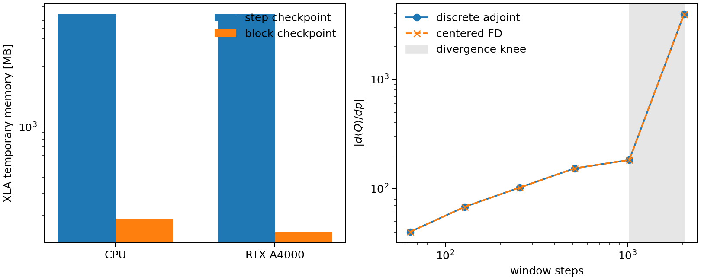

Nonlinear automatic differentiation
===================================

GKX uses one nonlinear derivative: a checkpointed discrete adjoint of a
post-saturation heat-flux window. It is the derivative of the code that runs,
not of a surrogate or a continuous-time approximation.

Objective
---------

Let :math:`G_{k+1}=\Phi_{\Delta t}(G_k;p)` be one projected Runge--Kutta step
and :math:`Q(G_k,p)` the gyro-Bohm heat flux. After a separate saturation run,
GKX differentiates

.. math::

   J(p)=\frac{1}{N_w}\sum_{k=N-N_w+1}^{N}
        Q(G_k,p), \qquad G_0=\operatorname{stop\_gradient}(G_{sat}).

``p`` may enter the species drives, field-line geometry, or both.

Discrete derivation
-------------------

Introduce one multiplier per executed time-step constraint,

.. math::

   \mathscr L=J+\sum_{k=0}^{N-1}\lambda_{k+1}^{T}
      \left[\Phi_{\Delta t}(G_k;p)-G_{k+1}\right].

Setting :math:`\partial\mathscr L/\partial G_k=0` gives the reverse recursion

.. math::

   \lambda_k = \left(\frac{\partial\Phi_k}{\partial G_k}\right)^T
               \lambda_{k+1}
               +\frac{1}{N_w}\left(\frac{\partial Q_k}{\partial G_k}\right)^T,

with the heat-flux term included only inside the chosen tail window. The design
gradient is

.. math::

   \frac{dJ}{dp}=\frac1{N_w}\sum_{k\in W}\frac{\partial Q_k}{\partial p}
      +\sum_{k=0}^{N-1}\lambda_{k+1}^{T}
       \frac{\partial\Phi_k}{\partial p}.

:math:`\Phi_k` is the implemented Runge--Kutta stage sequence followed by the
Hermitian projection. JAX supplies its vector--Jacobian products; GKX controls
only the checkpoint schedule. Thus the adjoint differentiates the executed
discrete map, including fields, collisions, nonlinear convolution, and
projection.

Why this method
---------------

An implicit root adjoint is inappropriate: saturated turbulence is a chaotic
trajectory, not a steady root. Long initial-value tangents also grow with the
leading Lyapunov exponent. The finite window gives a useful local design
direction while leaving the long, replicated nonlinear run as an independent
holdout.

Shadowing methods are better matched to the derivative of the long-time
average, but their cost scales with the unstable dimension and none has been
demonstrated for nonlinear gyrokinetics. GKX ships no shadowing method; the
windowed adjoint is its one nonlinear derivative.

Memory
------

A plain reverse scan stores :math:`O(N)` distribution states. GKX rematerializes
steps in blocks of length :math:`B` and retains block boundaries:

.. math::

   M(B)=O(N/B+B),\qquad B=\lceil\sqrt N\rceil,
   \qquad M=O(\sqrt N).

Checkpointing trades additional forward evaluations for lower memory use.
When ``adjoint_memory_budget_bytes`` (default 4 GiB) admits it, the window
retains one block's step residuals. The block length
:math:`B=\sqrt{NS/R}` minimizes :math:`(N/B)S+BR`, where :math:`S` is the
carry size and :math:`R` the step-residual size inferred from the abstract
pullback. Benchmark memory and runtime on the intended grid and backend.

Spectral zero mode
------------------

The :math:`k_\perp=0` mode is differentiated analytically. Near :math:`b=0`,
GKX evaluates :math:`\mathcal J_{\ell+1}=-\mathcal J_\ell b/[2(\ell+1)]`, so
:math:`d\mathcal J_1/db=-1/2` is retained even though
:math:`\mathcal J_1(0)=0`. The collision correction contracts its two
:math:`\sqrt b` factors as :math:`b`; this removes a removable ``sqrt(0)``
tangent singularity without changing the operator.

   Measured checkpoint memory and physical heat-flux AD/FD agreement. The
   gradient knee between 1024 and 2048 steps bounds the useful initial-value
   window for this Cyclone case.

Python use
----------

Run to saturation once, then differentiate the physical window:

.. code-block:: python

   saturated = gkx.integrate_nonlinear(
       initial, grid, geometry(theta0), params, dt, saturation_steps,
       method="rk3", terms=terms, return_fields=False,
   )

   def loss(theta):
       return gkx.nonlinear_heat_flux_window(
           saturated, grid, geometry(theta), params, dt, window_steps,
           method="rk3", terms=terms,
       )

   heat_flux, gradient = jax.value_and_grad(loss)(theta0)

The differentiated scan reuses one ``jax.jit`` graph for matching shapes,
dtypes, topology and static options. Geometry arrays are arguments, not captured
constants; changes to static configuration can recompile. :doc:`solvers` has the
compile counts, wall times and the identity gate. This qualification covers
complete nonlinear grids. Mode-selected linear and
reference grids carry array-valued ``ky_mode`` pytree metadata and are not
qualified inputs to the compiled nonlinear window.

The saturation state is fixed inside ``loss`` by design. For continuation,
refresh it after an accepted geometry step. Choose a window of several measured
heat-flux autocorrelation times, check the AD direction with a local line
search, and verify the final design with independent saturated runs.

``nonlinear_heat_flux_window`` also accepts ``collision_operator``, the same
custom model ``integrate_nonlinear`` takes. Pass it here whenever the saturation
run used one: a window differentiated without it is the derivative of different
physics from the trajectory it starts on.

On a linked (twist-shift) deck the saturated state is projected onto the linked
chain cover before the window starts, the same rule the runtime applies to a
supplied ``initial_state`` at intake: the kx rows outside the chains are
decoupled, and the bracket takes the whole state to real space while dealiasing
only its output, so content there would alias back onto the chain rows and
change the flux this objective returns. The gradient contract is unchanged --
the state stays detached and only ``geom`` and ``params`` carry derivatives --
and periodic decks are untouched. :doc:`solvers` has the rule and its
measurements.

Choosing the window
-------------------

Windows longer than the measured divergence knee emit a ``RuntimeWarning``. The
default knee is ``gkx.DIVERGENCE_KNEE_STEPS`` (1024), the last rung of the
ladder below whose adjoint still tracks a centered difference on the shipped
Cyclone case. It is a property of that trajectory's Lyapunov time, not a solver
tolerance, so remeasure it for a new case and then pass
``divergence_knee_steps=<measured>`` (or ``None`` to silence the check).
``examples/10_vmex_optimization/run.py`` runs at exactly 1024, one rung
below the departure.

Verification and scope
----------------------

Compare autodiff with centered finite differences across several perturbation
sizes and window lengths. Verify blocked and plain adjoints on the same
initial state before using checkpointing for a larger case. Repeat relevant
checks in the precision and device layout used by the production run.

A finite-window gradient describes the selected discrete trajectory. Chaotic
trajectory separation can invalidate a finite-difference comparison as the
window grows. Choose a window with stable agreement and assess any proposed
design change with independent long runs, replicated seeds, per-trace
stationarity and resolved transport spectra. See
:doc:`stellarator_optimization` for the uncertainty estimator.

Tests
-----

* mathematics: blocked and plain discrete adjoints are identical, including on
  a six-dimensional multi-species carry;
* numerics: Runge--Kutta order and AD/centered-FD agreement across the
  production switch matrix -- RK2/RK3/RK4, one and two species (including
  kinetic electrons), electrostatic and finite-:math:`\beta` electromagnetic,
  built-in hypercollisions, a custom collision operator, and all of them at
  once;
* physics: the differentiated diagnostic is GKX's physical total heat flux;
* optimization: the QA example uses the analytic VMEX and GKX derivatives.

References
----------

* Griewank & Walther, `Revolve <https://doi.org/10.1145/347837.347846>`_,
  *ACM TOMS* **26**, 19--45 (2000).
* JAX, `gradient checkpointing
  <https://docs.jax.dev/en/latest/gradient-checkpointing.html>`_.
* Mandell, Dorland & Landreman, `Laguerre--Hermite gyrokinetics
  <https://arxiv.org/abs/1708.04029>`_, *JPP* **84** (2018).
* Mandell et al., `GX <https://arxiv.org/abs/2209.06731>`_ (2022).
* Wang, Hu & Blonigan, `least-squares shadowing
  <https://arxiv.org/abs/1204.0159>`_, *JCP* **267**, 210--224 (2014).
