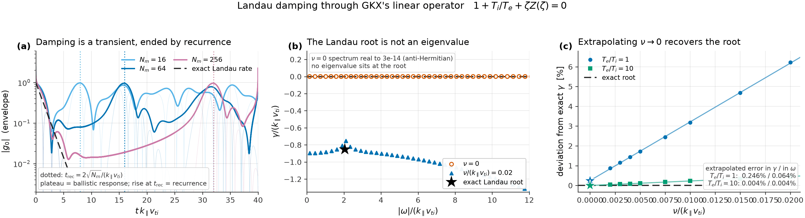

Numerics
========

This page describes how GKX discretizes and integrates the operator stated in
:doc:`operators`, the defaults a run takes when a deck leaves a choice open,
and the numerical checks behind them. Solver selection and eigenvalue
certification are covered in :doc:`solvers`.

Spectral discretization
-----------------------

Perpendicular coordinates are Fourier modes on a uniform grid in :math:`x` and
:math:`y`; the parallel coordinate is resolved in real space along the field
line, and differentiated spectrally. Velocity space uses a Hermite-Laguerre
basis. The state layout for one species is

``(N_l, N_m, N_y, N_x, N_z)``.

JAX execution model
-------------------

``jax.jit`` stages the integrators and ``jax.lax.scan`` drives the time loop.
Implicit time steps and shift-invert inner solves use ``solvax.gmres``
(right-preconditioned FGMRES); nonlinear IMEX reverse mode wraps it in
``solvax.linear_solve``, whose implicit-function VJP solves the transposed
system instead of differentiating the iterations. The Hermite line solve uses
``solvax.tridiagonal_solve``. ``solvax.chunked_jacfwd`` bounds memory for
geometry Jacobians; chunking changes batching, not the columns. Generic
algebra lives in SOLVAX (the floor is declared once, in ``pyproject.toml``);
state layout, linked-boundary assembly, preconditioner coefficients, branch
tracking, transport windows and physics gates stay in GKX. Module names are in
:doc:`design`.

Time integration algorithms
---------------------------

Linear integrators (:func:`gkx.solvers.linear.integrators.integrate_linear`)
share the cached operator data of
:func:`gkx.operators.linear.cache_builder.build_linear_cache`:

- **Explicit** ``rk2``, ``rk4``, ``sspx3``; **CFL-controlled**
  (``integrate_linear_explicit``), which recomputes the step from the linear
  max-frequency estimate (defaults ``rk4``, ``fixed_dt=False``, ``cfl=0.9``).
- **Diagonal IMEX** ``imex`` (first order) and ``imex2``: diagonal collision
  and hypercollision damping implicit, everything else explicit.
- **Backward Euler + GMRES** ``implicit``, with the physical preconditioner
  named in ``implicit_preconditioner``.

``imex2`` is the `ARS(2,2,2) split <https://doi.org/10.1016/S0168-9274(97)00056-1>`_.
For a diagonal non-negative damping :math:`D` and explicit remainder :math:`E`,
with :math:`\gamma=1-1/\sqrt{2}` and :math:`\delta=1-1/(2\gamma)`:

.. math::

   Y &= (I + \gamma hD)^{-1}\left(y_n + \gamma hE(y_n)\right), \\
   y_{n+1} &= (I + \gamma hD)^{-1}\left[y_n
      + h\delta E(y_n) + h(1-\delta)E(Y) - h(1-\gamma)DY\right].

It is second order and L-stable for pure damping; with :math:`D=0` its
stability polynomial is explicit midpoint's. Nonlinear runs use an explicit
scheme (``rk2``, ``rk3``, ``rk4``, ``sspx3``),
``imex`` (linear operator implicit by GMRES, bracket explicit) or the opt-in
``imex-ars3`` (:doc:`guidance`). The CFL prefactor ``cfl_fac`` is 1.73 for
``rk3``/``sspx3``, 2.82 for ``rk4``, 1.0 otherwise; nonlinear runs use 2.1 for
``rk3`` and 2.7 for ``rk4``, lower at large ``Nl * Nm`` (:doc:`inputs`). Reverse derivatives of the
IMEX route use the converged-system implicit derivative.

.. _lawson-steppers:

Integrating-factor steppers
---------------------------

The curvature and grad-B drift is diagonal in :math:`(s, k_y, k_x, z)` and
couples only neighbouring Hermite and Laguerre moments. For species :math:`s`

.. math::

   \partial_t g = L_d g + N(g), \qquad L_d = -i\left[a(s,k_y,k_x,z)\,C\otimes I + b(s,k_y,k_x,z)\,I\otimes B\right],

where :math:`a = t_{z,s}\,\omega_d\,(k_y\,\mathrm{cv} + k_x\,\mathrm{cv}_0)` and
:math:`b` likewise from the grad-B coefficients carry both the binormal and the
radial drift (:math:`t_{z,s} = T_s/Z_s`), :math:`C`
is the Hermite curvature matrix (:math:`C_{mm} = 2m+1`,
:math:`C_{m,m+2} = \sqrt{(m+1)(m+2)}`) and :math:`B` the Laguerre grad-B matrix
(:math:`B_{ll} = 2l+1`, :math:`B_{l,l+1} = l+1`), and :math:`N` is the rest of the
right-hand side: streaming, mirror force, the field response of the drift,
diamagnetic drive, dissipation and the :math:`E\times B` bracket. Both matrices
are real symmetric after truncation, so :math:`C = V_c\,\mathrm{diag}(c)\,V_c^{T}`,
:math:`B = V_b\,\mathrm{diag}(\beta)\,V_b^{T}` hold exactly for the truncated
operator, and

.. math::

   e^{-ih\,(aC + bB)} = (V_b\otimes V_c)\;\mathrm{diag}\!\left[e^{-ih\,(a c_j + b \beta_k)}\right](V_b\otimes V_c)^{T}

is a diagonal phase between two orthogonal moment transforms, with no
truncation error beyond the truncation of the operator itself. ``lawson-rk3``
(Heun's third-order method), ``lawson-rk4`` and ``lawson-rk4-pi`` (RK4 with
the embedded midpoint error estimate) are the Lawson forms of ``rk3``,
``rk4`` and ``rk4-pi``: with :math:`E(\theta) = e^{\theta h L_d}` and
:math:`N_j = F(Y_j) - L_d Y_j`, stage :math:`i` is
:math:`Y_i = E^{c_i} y + h\sum_j a_{ij} E^{c_i - c_j} N_j` and the update is
:math:`E y + h\sum_j b_j E^{1-c_j} N_j`. The transforms are applied through the
production curvature and grad-B routines' matrices, so the exponential equals
``expm`` of the production operator to round-off (tested), and the phases are
rebuilt from the step each time, so an adaptive step costs one pair of
exponentials. Because the drift is advanced exactly, the CFL bound of these
methods leaves out the radial and binormal drift frequencies and keeps the
streaming rate and the :math:`E\times B` rate; the diamagnetic drive was
already outside the nonlinear bound.

Measured on one A4000 (float32) against the plain steppers. Cyclone, 64x64x24,
:math:`(N_l, N_m) = (4, 8)`, :math:`t = 400`, four seeds; :math:`Q` is the
saturated heat flux with the standard error over seeds.

.. list-table::
   :header-rows: 1

   * - Stepper
     - ``cfl_fac``
     - steps
     - :math:`Q`
   * - ``rk4`` (reference)
     - 0.9
     - 20410
     - 8.85 +- 0.17
   * - ``rk3``, ``rk4``, ``rk4-pi``
     - 2.1, 2.7, 2.82
     - 8745, 6810, 3487
     - 8.83 +- 0.10, 8.76 +- 0.18, 8.74 +- 0.12
   * - ``lawson-rk3``
     - 2.5
     - 4227
     - 9.07 +- 0.12
   * - ``lawson-rk4``
     - 2.5, 3.5
     - 4220, 3014
     - 8.97 +- 0.04, 8.84 +- 0.10
   * - ``lawson-rk4-pi``
     - 2.82
     - 2388
     - 8.86 +- 0.03

The linear growth rate and frequency of the selected mode agree with ``rk4``
at :math:`h = 0.02` to :math:`2\times10^{-5}` (Cyclone, :math:`k_y = 0.3`,
:math:`\gamma = 0.09656`, ``lawson-rk3`` and ``lawson-rk4`` up to :math:`h = 0.1`)
and to :math:`5\times10^{-4}` in :math:`\gamma`, :math:`1.3\times10^{-3}` in
:math:`\omega` (QHS, :math:`k_y = 0.4`, ``lawson-rk4`` at :math:`h = 0.1`).
The largest stable ``cfl_fac`` (bisection, finite, peak :math:`Q` below twice
the first stable run's, mean step within 30% of the CFL step) is 3.9 to 5.2 for
``lawson-rk3`` and 3.9 to 4.8 for ``lawson-rk4`` at :math:`N_lN_m = 32`
(Cyclone, EM :math:`\beta = 0.01`, Miller, HSX, W7-X QI), 2.75 and 3.9 with
kinetic electrons at 64 moments and 3.4 for both at 128. At that edge the mean
step is 1.7 to 3.5 times that of ``rk3``/``rk4`` on the tokamak decks, 1.2 to
1.5 times on the stellarator decks, and 1.0 with kinetic electrons, where the
electron streaming rate, which the exponential does not touch, sets the step.
The ``rk4-pi`` step is error-controlled and capped at twice the CFL step, so its
gain is smaller (step cap lifted): 1.5 times fewer steps on Cyclone, Miller and EM
:math:`\beta = 0.01` decks, 2.5 at :math:`(8, 16)`, 1.1 on HSX and W7-X QI,
1.0 with kinetic electrons. The two transforms and the phases cost 12% to 28%
(``lawson-rk3``, ``lawson-rk4``) per step at :math:`(4, 8)` and 8% to 12% at
:math:`(8, 16)` on a 64x64x24 box (quiet GPU, two passes, before the paired-FFT bracket).
On the current tree the cost per step of ``lawson-rk4-pi`` against ``rk4-pi``, read from
the end-to-end runs of the table below (setup subtracted, a GPU shared with another job
throughout), is 1.1 to 1.3 times (median 1.2, 12 of 14 decks; one deck read 1.9 and one 0.6).

.. _lawson-limits:

*Where it pays, and the automatic choice.* ``method = "auto"``, the default of a
nonlinear deck with no ``dt``, reads the linear frequency bound of the run (radial
and binormal drift, parallel streaming; diamagnetic drive left out) and the step cap
(``dt_max``, else ``dt``; 0.1 unless the deck says otherwise) and takes
``lawson-rk4-pi`` when both hold, ``rk4-pi`` otherwise:

- the drift share :math:`(\omega_x + \omega_y)/(\omega_x + \omega_y + \omega_\parallel)`
  is at least 0.56: the exponential removes that part of the explicit step limit;
- the step cap is at least 2.6 times the ``rk4-pi`` bound step
  (:math:`\mathrm{cfl\_fac}\cdot\mathrm{cfl}/\sum\omega`): below that, the error-controlled
  ``rk4-pi`` already runs at the cap or within a factor 1.3 of it, and the dearer
  ``lawson-rk4-pi`` step (the two transforms and the phases) buys no steps.

The sharded routes and decks with per-species moment counts take ``rk4-pi``. The cap
matters because the controller of ``rk4-pi`` raises its step above the bound until it
meets the cap: with the shipped cap 0.1, ``lawson-rk4-pi`` takes 2000 steps to
:math:`t = 200` on every deck below, and ``rk4-pi`` takes about as many unless its bound
step is well below the cap. Steps do not depend on the device; the wall column (lowest of the
runs, setup included) is from a GPU shared with another job, so it reads a few percent
to 20% either way.

.. list-table::
   :header-rows: 1

   * - Deck, 64x64x24 Cyclone unless noted
     - drift share
     - cap / bound
     - choice
     - steps :math:`t = 200`, ``rk4-pi`` / ``lawson-rk4-pi``
     - wall ``lawson`` / ``rk4-pi``
   * - (4, 6), (4, 8), EM :math:`\beta` 0.01
     - 0.56, 0.58, 0.58
     - 1.3, 1.6, 1.6
     - ``rk4-pi``
     - 1.01, 1.01, 1.01
     - 0.8 to 1.1, 1.17, 1.05
   * - HSX (QHS)
     - 0.49
     - 1.45
     - ``rk4-pi``
     - 1.01
     - 1.10
   * - (8, 8), (4, 12), (6, 12)
     - 0.62, 0.61, 0.63
     - 1.8, 2.2, 2.25
     - ``rk4-pi``
     - 1.17, 1.29, 1.49
     - 1.05, 1.32, 0.89
   * - Miller, W7-X QI
     - 0.71, 0.48
     - 2.4, 2.4
     - ``rk4-pi``
     - 1.23 to 1.26, 1.11
     - 1.00, 1.00
   * - HSX (QHS), (8, 16)
     - 0.58
     - 2.5
     - ``rk4-pi``
     - 1.24
     - 0.96
   * - Cyclone, (4, 16)
     - 0.64
     - 2.7
     - ``lawson-rk4-pi``
     - 1.73
     - 0.77
   * - Cyclone, (8, 16)
     - 0.66
     - 2.9
     - ``lawson-rk4-pi``
     - 2.20
     - 0.54
   * - Miller, (8, 16)
     - 0.78
     - 4.4
     - ``lawson-rk4-pi``
     - 3.31
     - 0.34
   * - ETG, :math:`(16, 8)`, ``dt_max`` 0.001
     - 0.80
     - 2.8
     - ``lawson-rk4-pi``
     - 6.7 against ``rk4`` (3328 / 500 steps, :math:`t = 0.5`)
     - 0.24
   * - kinetic electrons, :math:`\beta` 0.015
     - 0.01
     - -
     - ``rk4-pi``
     - 1.0
     - 1.06

The break-even is a step ratio equal to the cost ratio per step (1.1 to 1.35 over the
measurements, so about 1.25); the threshold of 2.6 sits where the ratio is at least 1.7
on the measured decks, and the ties between 2.4 and 2.5 stay on ``rk4-pi``. With the cap
lifted (``dt_max`` large, the setting of the 400-time-unit table above) the second
condition is met everywhere and the drift share alone decides, as in the first
measurements of this method: the crossover on the Cyclone ladder is between 0.556 and
0.577, and ``lawson-rk4-pi`` takes 1.46 times fewer steps than ``rk4-pi`` at
:math:`(4, 8)`, 1.5 on Miller and EM, 2.6 at :math:`(8, 16)`.

The saturated flux agrees within the seed scatter on the Cyclone-family decks
(Cyclone :math:`(4, 8)`, :math:`t = 200`, one seed: 9.24 +- 0.25 against 9.52 +- 0.23), with
kinetic electrons and on W7-X QI (6.74 +- 0.24 against 6.57 +- 0.28). The HSX flux was measured to saturation with the cap lifted: four seeds each, :math:`t = 400`, window from the first crossing of the second-half median (not before :math:`0.2\,t_\mathrm{end}`), Sokal correlation-time errors, 7.13 +- 0.19 for ``rk4-pi`` and 6.79 +- 0.05 for ``lawson-rk4-pi`` (seed-to-seed standard errors; the paired difference is -0.34 +- 0.15, 1.7 standard errors, of the opposite sign to the 4% excess of a shorter window). At saturation, with the cap lifted, ``lawson-rk4-pi`` takes 1.85 times more steps than ``rk4-pi`` on HSX: the error estimate, not the CFL bound, sets its step. The error estimate of
``lawson-rk4-pi`` is larger than the plain one at equal step, so where accuracy sets
the step it takes more steps than ``rk4-pi``. The methods need the Laguerre-coefficient
basis and one moment layout for all species, and run only on the explicit diagnostic
route, not on the sharded or sheared-coordinate ones.

.. _first-run-defaults:

What a first run gets
---------------------

Defaults for a deck that leaves a choice open, each backed by a
load-independent measurement (:ref:`q28-defaults`):

- **Eigen route:** ``auto``, banded direct shift-invert where it fits, else
  ``adaptive``, the residual-certified propagator eigensolve (:doc:`solvers`).
- **Precision:** ``complex64``. On ``01_linear_tokamak/case_full.toml`` float32
  gives :math:`\gamma = 0.09309106` against float64's :math:`0.09309117`
  (1.2e-6 relative); ``JAX_ENABLE_X64=true`` applies the float64 certification
  gate (1e-9 against 1.19e-4) at about 17% more memory.
- **Step:** a deck that sets ``[time] dt`` keeps ``rk2`` at that step; a deck
  without ``dt`` gets ``rk4`` with the CFL controller. Fixed-step linear paths
  warn when ``dt`` exceeds the CFL estimate.
- **Resolution:** ``(Nl, Nm) = (12, 24)`` linear, ``(4, 8)`` nonlinear, a
  starting point and not a convergence statement.
- **Nonlinear horizon:** diagnosed runs stop at saturation, with ``t_max`` as
  the cap (:ref:`saturation-stop`).
- **Unchanged:** two-thirds dealiasing; ``collisions`` and ``hypercollisions``
  enabled as terms with per-species ``nu = 0``; the persistent compilation
  cache on, so a second run skips compilation; the CPU FFT thread pool stays
  on (single-threaded measured 8--10% slower).

.. _q28-defaults:

Default selection and convergence
---------------------------------

Defaults provide a starting resolution and timestep policy. They do not set a
physics error bound. Check Hermite and Laguerre truncations separately, compare
fit windows or residual-certified modes, and vary numerical regularization.
A non-monotone resolution ladder requires additional points before drawing a
convergence conclusion.

.. _saturation-stop:

Saturation stop policy
----------------------

A diagnosed nonlinear run with ``run_to = "saturation"`` (the default)
integrates in chunks and asks
:func:`gkx.diagnostics.saturation.assess_saturation` for a verdict on the
accumulated per-species heat-flux trace. It stops when the verdict is
``saturated`` and otherwise runs to ``t_max``, where the status is recorded as
``cap_reached:<status>``.

The assessment works in physical time, so it does not depend on the step size,
the diagnostic cadence or the mass ratio. The trace is resampled onto a uniform
grid (at most :math:`0.5\,a/v_t` wide) by integrating the piecewise-linear
signal, and looked at every :math:`\max(25,\,5\%\ \text{of the elapsed time})`
:math:`a/v_t`, not every chunk. The start-up transient is not located by a
threshold crossing. It is cut by MSER [White97]_: the truncation point, over at
most the first 35% of the trace, that minimises the variance of the remaining
block means per retained block. This removes the post-linear overshoot as well
as the growth phase. On the retained window:

#. :math:`\tau` is the integrated autocorrelation time with Sokal's automatic
   window :math:`M \ge 5\tau` [Sokal97]_.
#. The standard error comes from batch means [Flegal08]_ with blocks of at
   least :math:`4\tau` and at least ten blocks, so the block means are close to
   independent. A window with fewer than ten blocks has no error estimate.
#. Drift is the ordinary-least-squares slope of the block means. It is flagged
   when the change across the window exceeds ``saturation_drift_rel`` (10%) of
   the scale and the slope is more than two standard errors from zero.
#. Every species and the total must pass. The scale is
   :math:`\max(|\text{mean}|,\ 0.2\sum_s|\text{mean}_s|)`, so a total that
   cancels between ion and electron channels is judged against the channels.
#. The same verdict must already have held when the last 20% of the window was
   absent, with means that agree within two combined standard errors.

``Wphi`` and ``Wg`` are no longer stop gates: with a physical-time window the
flux drift test covers what they were guarding, and they sat at their own
transients in the cases that never converged.

.. list-table::
   :header-rows: 1
   :widths: 22 78

   * - ``status``
     - Meaning
   * - ``too_short``
     - less than ``saturation_t_min`` has run, or the window after the cut is
       shorter than 250 :math:`a/v_t`
   * - ``growing``
     - the quarter means of the whole trace keep rising, the last by more than
       50% and the one before by more than 20% (linear phase or slow saturation)
   * - ``quiescent``
     - the last quarter has decayed below 1% of the peak (linearly stable); the
       mean is not reported
   * - ``drifting``
     - the window mean is moving, per item 3
   * - ``intermittent``
     - the window is shorter than :math:`30\tau`, has fewer than ten blocks, or
       the relative SEM exceeds ``saturation_rel_sem`` (10%)
   * - ``unconfirmed``
     - passes now but failed the 80%-prefix check of item 5
   * - ``saturated``
     - all gates pass; ``mean`` and ``sem`` are the window mean and its batch-means
       standard error
   * - ``cap_reached:<status>``
     - ``t_max`` was reached without ``saturated``

Nothing is called saturated before ``saturation_t_min = 800`` :math:`a/v_t`.
Published practice is of that order: the GX stellarator flux database of
Landreman et al. [Landreman25]_ discards :math:`t<150` and runs to 800 :math:`a/v_t`,
CGYRO production runs use at least 500 :math:`a/c_s`, and GENE averaging windows
are of order 1000. A run with ``t_max`` below ``saturation_t_min`` can still
report ``saturated`` at its cap. The Oberparleiter et al. stopping rule
[Oberparleiter16]_ motivates stopping on an error estimate rather than a
fixed time.

These are finite-sample safeguards, not a sequential-confidence guarantee. On
stationary synthetic traces the quoted SEM covers the true mean about 85% of
the time at two standard errors (nominal 95%), because the transient cut and the
verdict are chosen from the same data. The status is written as ``status`` under
``saturation`` in the summary JSON and printed by the executable, next to
``saturated``, ``mean``, ``sem``, ``rel_sem``, ``tau_ac`` and the window
``window_tmin``/``window_tmax``. A prepared simulation (``gkx.prepare``)
compiles a fixed length, so it refuses ``run_to = "saturation"`` unless given
``steps=N``.

Distributed state sharding
--------------------------

``TimeConfig.state_sharding = "auto"`` (or ``"ky"``/``"kx"``) partitions the
packed nonlinear state over several JAX devices; with one device it is ignored.
``"z"`` is rejected (the FFT-axis decomposition has not passed its identity
gate) and the sharded path refuses a non-default ``collision_operator``. Active
multi-device CPU sharding is skipped on macOS because XLA CPU FFT layouts can
abort. A speedup claim needs its own identity, transport-window and profiler
gates.

Nonlinear FFT bracket
---------------------

The :math:`E\times B` term is pseudospectral. By default
(``compressed_real_fft = true``) gradients come from the ``N_y/2+1``
non-negative-:math:`k_y` spectrum, matching the reference layout and minimizing
memory traffic. Electromagnetic runs stack ``J0*phi``, ``J0*apar`` and the
``bpar`` correction into one FFT batch.

*Limitation (#336).* The ``"grid"`` Laguerre bracket advects with the node-space
:math:`J_0\phi` and keeps the first ``Nl`` coefficients, while quasineutrality
uses the analytic :math:`J_\ell`. The retained energy is then conserved only to
about :math:`7\times10^{-8}` of the bilinear scale at ``Nl = Nm = 4``. Treat
it as a resolution diagnostic, converged in ``Nl`` (Mandell, Dorland &
Landreman 2018, section 4.1).

The ``ky`` layout contract
--------------------------

:mod:`gkx.core_ky_layout` owns every conversion between two layouts of the
``ky`` axis. ``full`` is the two-sided ``fftfreq`` order with ``Nky = Ny``; the
runtime evolves it. ``half`` is the non-negative ``rfftfreq`` rows,
``Nyc = 1 + Ny // 2``; GX, stella and GS2 evolve it, and GKX uses it for
restarts, NetCDF output, spectra and snapshots. A real field obeys
:math:`F(-k_y, -k_x, z) = F^{*}(k_y, k_x, z)`. Three rules:

- ``Nyc`` does not determine ``Ny``: widening takes ``ny_full`` explicitly.
- Row 0, and row ``Ny/2`` for even ``Ny``, are self-conjugate:
  :math:`F(k_x) = F^{*}(-k_x)` within the row. Storing ``ky >= 0`` does not
  enforce it; operators that write those rows call
  ``symmetrize_self_conjugate_rows``.
- Reductions of quantities even in :math:`k_y` use
  ``ky_row_weights`` (2 on paired rows, 1 on self-conjugate rows), never a
  blanket factor of two, which over-counts the Nyquist row. A flux on that row
  vanishes for a real field, and two-thirds dealiasing zeroes it anyway.

``[grid] ky_layout = "half"`` is the default; ``"full"`` is the opt-out. On
Cyclone at ``24x24x24`` to ``64x64x24`` the two layouts agree to 2e-16 (x64) and
2e-7 (float32) in the nonlinear diagnostics, with even and odd ``Nyc``, with
``state_sharding = "ky"`` on four forced CPU devices, and bitwise in the
heat-flux window value and gradient; ``"half"`` runs the window gradient in 0.68
(CPU) to 0.72 (GPU) of the two-sided time (:doc:`performance`).

Equilibrium-flow shearing coordinates
-------------------------------------

A research path, not an input option.
:func:`gkx.operators.nonlinear.projection.advance_shearing_coordinates`
follows :math:`k_x^*(t) = k_x(0) - k_y\gamma_E t`. When the displacement
crosses half a radial cell the state moves to the nearest :math:`k_x`, the
sub-cell residual is kept in the wavenumber and the phase
:math:`\exp(i\,\delta k_x x)` (the corrected remap of [McMillan19]_), and
modes leaving the two-thirds band are zeroed. The remap is piecewise constant
with a stopped tangent; wavenumbers and phases stay differentiable between
remaps. Non-twist tubes are refused. There is no parallel-velocity-gradient
drive [Schekochihin12]_ [Ball19]_. Shear is expected to decorrelate turbulence
once the shearing rate exceeds the instability rate [Biglari90]_ [Waltz95]_;
the gate below tests that. Integrators:
``integrate_nonlinear_sheared`` (RK2, RK3, fixed-step IMEX) and
``integrate_nonlinear_sheared_transport``. Treatment effects are judged with
``matched_nonlinear_transport_report``, not by comparing two chaotic traces.

Flow shear remains a research API. Validate its response with matched,
stationary windows and resolution studies before assigning a physical effect.

.. _end-damping:

Parallel boundary and end damping
---------------------------------

A linked (twist-and-shift) chain is a finite piece of the infinite ballooning
line. Its spectral :math:`z` derivative is periodic over the chain, so what
streams out of one end would re-enter at the other. GKX absorbs it in a layer
at each end of every non-zonal chain:

.. math::

   \partial_t h \;\mathrel{+}= -\nu_{end}\, d(z)\, h, \qquad
   d = 1 - \frac{2x^2}{1 + x^4},\quad x = \frac{\text{distance from the chain end}}{L_w},

with :math:`L_w` = ``damp_ends_widthfrac`` (0.125) of the chain. The damped
quantity is the non-adiabatic :math:`h`, as in GX.

**Contract.** :math:`\nu_{end}` is a rate in :math:`v_{ti}/a` units and the
same on every route: time integration (any step, fixed or adaptive), Krylov,
eigen, shift-invert and nonlinear. No timestep enters. ``[time]
damp_ends_rate`` sets it. The default is

.. math::

   \nu_{end} = C\,\frac{\max_s v_{ts}\,|\hat b\cdot\nabla z|}{w\,L_z},\qquad C = 30,

that is, 30 e-folds per thermal transit of the fastest kinetic species across a
layer of one segment (:math:`L_z` is the stored :math:`z` extent). Each run
prints the rate it uses (``end damping: rate ...``). A deck that sets only the
legacy ``damp_ends_amp`` is refused.

**Why a rate.** GX applies ``damp_ends_amp/dt`` (before February 2023,
:math:`5 v_{max}/L`). Read as a rate, :math:`A/\Delta t` makes a timestep-free
eigenvalue depend on a step it does not have. GS2 [KRT95]_ and stella [BPL19]_
need no absorber (upwinded implicit streaming sets :math:`h = 0` for incoming
particles); GENE truncates the :math:`k_x` connection and uses parallel
hyperdiffusion [PDJ10]_. A Hermite basis does not separate :math:`v_\parallel`
directions, so GKX keeps GX's layer and fixes only its units.
A GX nonlinear run applies :math:`A/\Delta t` at its own step, so matching it
means setting ``damp_ends_rate`` to :math:`A/\Delta t_{GX}`. Match the same
absorbing-layer policy before comparing transport.

Vary the end-damping rate and parallel domain together when checking a linked
boundary. Report the rate, width and timestep policy in cross-code comparisons.
An absorbing layer is a numerical regularization and its influence must be
separated from collisional and collisionless damping.

.. [KRT95] M. Kotschenreuther, G. Rewoldt, W. M. Tang, Comput. Phys. Commun. 88, 128 (1995).
.. [BPL19] M. Barnes, F. I. Parra, M. Landreman, J. Comput. Phys. 391, 365 (2019).
.. [PDJ10] M. J. Pueschel, T. Dannert, F. Jenko, Comput. Phys. Commun. 181, 1428 (2010).

De-aliasing and hyperdiffusion
------------------------------

Nonlinear brackets use the standard ``2/3`` de-alias mask, stored on the
spectral grid and applied inside the bracket. Perpendicular hyperdiffusion
(``D_hyper``, ``p_hyper_kperp`` and the ``hyperdiffusion`` term weight; see
:doc:`operators`) is available as scale-selective damping and is off by
default. :math:`k_{\perp,\max}` is taken from the full grid's dealiased corner,
also when a linear run keeps only a subset of ``ky`` rows.

Linear solver options
---------------------

- **Batched ``ky`` scans:** ``ky_batch>1`` integrates several ``ky`` at once;
  ``fixed_batch_shape=True`` pads the last batch to avoid recompiling.
- **Implicit preconditioners** (``implicit_preconditioner``): ``"auto"``/
  ``"diag"``/``"physics"``/``"block"``, ``"damping"``, ``"pas"``,
  ``"pas-coarse"``, ``"hermite-line"``, ``"hermite-line-coarse"``,
  ``"identity"``.
- **Shift-invert preconditioners** (``KrylovConfig.shift_preconditioner``):
  ``"damping"``; ``"hermite-line"`` (FFT in :math:`z` plus a tridiagonal
  Hermite solve of the diagonal-plus-streaming symbol, :math:`O(n)`);
  ``"field-corrected"`` (the line plus the exact field response by a Woodbury
  capacitance solve); ``"pr3-cm"`` (below). ``"auto"`` is ``"pr3-cm"`` with the
  inner FGMRES raised to restart 150 and maxiter 600 (:doc:`algorithms`).
- **Acceptance:** every shift-invert pair is checked against the matrix-free
  relative residual
  :math:`\lVert Av-\lambda v\rVert/\max(\lVert Av\rVert,|\lambda|\lVert v\rVert)`
  with ``shift_outer_residual_tol`` (``1e-6``); rejected pairs raise. The
  eigenvalue is refreshed as the physical Rayleigh quotient.
- **Branch selection:** ``KrylovConfig.mode_family`` (``"cyclone"``, ``"etg"``,
  ``"kbm"``) and ``shift_selection``; ``fallback_method`` defaults to
  ``"propagator"``. Retained-Ritz thick restarts, projected Jacobi--Davidson
  and reduced Schur complements were tried for interior KBM eigenpairs, all
  chose the wrong branch, and none is shipped.
- **Reusable IMEX operators:** ``build_nonlinear_imex_operator`` prebuilds the
  matrix-free operator for ``integrate_nonlinear_imex_cached``.

The inner solves are right-preconditioned FGMRES started from zero. On the
first right-hand side of the outer Arnoldi (Cyclone, ``(Nz, Nl, Nm) = (96, 4,
8)``, float64) three GMRES(20) cycles from zero leave relative residuals of
0.995 (``hermite-line``), 0.9995 (``field-corrected``), 0.86 (``damping``) and
0.299 (``pr3-cm``); only ``pr3-cm`` converges unrestarted (9.9e-5 in 252
iterations), so raise ``shift_restart`` and ``shift_maxiter`` together.

``pr3-cm`` (``solvers/linear/preconditioner.py``) splits the operator into two
halves, each invertible in closed form, and sweeps between them. The Hermite
line solve inverts streaming, hypercollisions and the *z*-mean of the drift.
The rest (exact :math:`\omega_d(z)`, mirror, drive, end damping, collisions,
local field response) is *z*-local: dense :math:`(l, m)` blocks per
``(species, ky, kx, z)``. One Peaceman--Rachford double sweep costs one solve of
each and no operator application; ``pr3-cm`` is three sweeps from zero, with
:math:`\alpha = -\sqrt{s_1 d}` unless ``shift_precond_alpha`` is set. The
*z*-local block is solved by block-Thomas elimination in the Laguerre index plus
a Sherman--Morrison correction for the rank-one field part
(``solvax.block_thomas_factor_ops``), 1.5x to 2.7x smaller than a dense-band
factor. If the block is not *l*-tridiagonal, ``shift_precond_block_solve =
"auto"`` falls back to the dense batched inverse and records why; the build
also checks that the non-streaming operator is *z*-local and refuses otherwise
(zonal rows under adiabatic electrons fail it).

Automatic solver and fit-signal selection
-----------------------------------------

``solver = "auto"`` (default) runs the time path and falls back to the Krylov
eigensolve when the fitted ``(gamma, omega)`` is non-finite or violates
``require_positive``. ``fit_signal = "auto"`` fits both the ``phi`` and density
traces with the same windowing rules and keeps the higher score. Set
``solver = "time"``, ``"explicit_time"`` or ``"krylov"`` and ``fit_signal =
"phi"`` or ``"density"`` to override.

Custom collision operators
--------------------------

Shipped models and the Python protocol are in :doc:`operators`. A custom
operator is any JAX-compatible object with ``apply(context)``, passed as
``collision_operator=`` to ``linear_rhs``, ``linear_rhs_cached``,
``integrate_linear`` or ``nonlinear_rhs_cached``. It runs on serial explicit and
IMEX linear integration and serial explicit nonlinear integration; implicit
linear solves, nonlinear IMEX, sheared IMEX and decomposed integration refuse
it. The finite-Larmor-radius coefficients are cancellation-sensitive, so they
are generated offline in multiple precision with their provenance and loaded as
compact arrays. Frei, Hoffmann & Ricci write the Bessel argument as
:math:`B=k_\perp\sqrt{2\tau}`; the runtime interpolates at :math:`B=\sqrt{2b}`.
The operator identities and source tables are checked by the collision tests.

Landau damping against the exact kinetic roots
----------------------------------------------

The slab ion-acoustic dispersion relation with adiabatic electrons at
:math:`k_\perp \to 0`,

.. math::

   1 + \frac{T_i}{T_e} + \zeta Z(\zeta) = 0,
   \qquad
   \zeta = \frac{\omega}{k_\parallel \sqrt{2T_i/m_i}},

with :math:`Z` the plasma dispersion function (``scipy.special.wofz``), has no
free parameters. ``test_landau_root_recovered_by_collisional_extrapolation``
evolves the production operator at :math:`N_m = 64` and requires the
:math:`\nu \to 0` extrapolation within 1% in :math:`\gamma` and 0.5% in
:math:`\omega` of the root, at :math:`T_e/T_i = 1` and 10.

   Produced by ``linear_rhs_cached``; panel (b) eigen-decomposes the same
   operator.

Four traps give plausible but wrong numbers (all gated in
``tests/validation/physics_gates/test_collision_physics.py``):

1. A collisionless truncated Hermite system cannot Landau damp: free streaming
   is anti-Hermitian, so the spectrum is real (:math:`\max|\mathrm{Re}\,\lambda|
   < 10^{-11}`) and any fitted rate is a transient that ends at recurrence.
2. The Landau root is a pole of the continued response, not an eigenvalue. Add
   collisions, measure the decay at several small :math:`\nu`, extrapolate.
3. A density perturbation with no flow is a standing wave; fit
   :math:`A e^{\gamma t}\cos(\omega t + \phi)`, not an unwrapped phase.
4. ``tau_e`` is :math:`T_i/T_e`; the reciprocal is invisible at :math:`T_e=T_i`.
   GKX normalizes to :math:`v_{ti}=\sqrt{T/m}`, not :math:`\sqrt{2T/m}`.

.. _hermite-closure:

Hermite closure and recurrence
------------------------------

Terminating the ladder with :math:`G_{M+1} = 0` is a reflecting boundary: free
energy returns to the low moments as recurrence at
:math:`t_{\mathrm{rec}} \simeq 2\sqrt{M}/(k_\parallel v_{th})`. Because that
grows only as :math:`\sqrt{M}`, the end of the ladder must absorb. GKX has two
treatments.

**Hypercollisions** (default, ``[physics] hypercollisions = true``) damp a band
of high moments with the :math:`|k_z|`-scaled branch
:math:`\propto \nu_{hyper,m}|k_z|(m/M)^{p_m}` (``nu_hyper_m``, ``p_hyper_m``;
:doc:`operators`).

**Reflectionless closure** (opt-in per species with ``[[species]]
hermite_closure = "reflectionless"``, ``LinearParams.closure``; in the Python
streaming kernel ``hermite_closure="reflectionless"``) applies the
outgoing-wave condition of
Kanekar et al., *J. Plasma Phys.* **81**, 305810104 (2015), Eq. (4.36):

.. math::

   G_{M+1} = -\,i\,\mathrm{sgn}(k_\parallel)\,R_{M+1}\,G_M,
   \qquad
   R_{M+1} = \frac{M}{\sqrt{2(M+1)}}
             \frac{\Gamma(M/2)}{\Gamma\!\left((M+1)/2\right)},

a single sink :math:`-R_{M+1}\sqrt{M+1}\,v_{th}|k_\parallel|\,G_M` on the last
moment. :math:`R_{M+1} \to 1 - 1/(4M)`, so the absorption becomes exact with
resolution; :math:`R_{M+1} > 0` makes it a positive-definite energy sink; and it
touches only :math:`m = M`. At :math:`M = 2` it reduces to the Hammett-Perkins
three-pole coefficient 0.921318. The test
``test_absorbing_closures_beat_truncation_on_both_metrics`` requires each
treatment to cut the revived :math:`|g_0|` below a tenth of truncation's and
to keep the pre-recurrence error below 0.1, since suppression alone rewards any
strong damping. It carries no free parameter but is not a drop-in replacement
for a tuned hypercollision.

For a species with ``hermite_closure = "reflectionless"`` the sink replaces that
species' :math:`|k_z|` hypercollision band; it reuses the linked parallel
transform of that branch (no extra FFT) and appears in the explicit, implicit
and Hermite-windowed routes. It acts only where ``[physics] hypercollisions``
is on. Other species, and the constant Laguerre branch and collision operator
of the closed species, are untouched; with the key omitted the right-hand side
is bitwise the one without the closure. The mixed species-Hermite electrostatic
route refuses it.

*Measured effect.* Dannert-Jenko trapped-electron mode (Miller :math:`q=1.4`,
:math:`\hat s=0.8`, :math:`T_e/T_i=3`, :math:`R/L_n=3`, :math:`R/L_{Te}=6`,
:math:`m_i/m_e=1836`, :math:`\beta_e=10^{-3}`, :math:`A_\parallel`,
:math:`N_l=8`, ``rk4``, float64). Linear growth rate, hypercollision / closure,
against GS2:

.. list-table::
   :header-rows: 1

   * - :math:`k_y\rho_s`
     - ``Nm`` 16
     - ``Nm`` 32
     - ``Nm`` 48
     - ``Nm`` 96
     - GS2
   * - 0.2
     - 0.349 / 0.388
     - 0.468 / 0.487
     - 0.531 / 0.537
     - 0.601 / 0.613
     - 0.675
   * - 0.3
     - 0.624 / 0.661
     - 0.786 / 0.806
     - 0.855 / 0.865
     - 0.938 / 0.949
     - 1.005
   * - 0.5
     - 0.991 / 1.028
     - 1.203 / 1.229
     - 1.282 / 1.298
     - 1.367 / 1.378
     - 1.402

The closure raises :math:`\gamma` by 4 to 11 % at ``Nm`` 16 and by 1 to 2 % at
``Nm`` :math:`\ge` 48; at :math:`k_y\rho_s = 0.3`, ``Nm`` 192 gives 0.969 /
0.974. The frequency does not move (-0.922 / -0.923 at ``Nm`` 96), and the
:math:`\gamma` deficit against GS2 at ``Nm`` 48 is 21/15/9 % with hypercollisions
and 20/14/7 % with the closure. Electron-temperature-gradient mode (GS2
:math:`k_y=10`, 3.988 / -6.212, :math:`N_l=24`): ``Nm`` 32 3.988 / -6.227 against
3.986 / -6.229, ``Nm`` 16 4.022 / -6.200 against 4.028 / -6.202, so no
degradation where hypercollisions already converge. The explicit step bound is
unchanged: the Arnoldi radius of streaming, fields and the Hermite damping is
4887 / 10157 / 15009 (hypercollisions) and 5523 / 10717 / 15708 (closure) at
``Nm`` 16 / 48 / 96, equal to streaming alone within 1 %, and the wall time at
``Nm`` 48 is 181 s against 182 s.

*Nonlinear check.* The same trapped-electron case as a small nonlinear box
(:math:`8\times8\times32`, :math:`N_l=4`, random initial phases, ``rk4``,
electromagnetic, same seed for every row), once with each closure on the
electrons. The effective growth rate of :math:`W_\phi` before saturation is
0.95 to 0.97 at ``Nm`` 16 with hypercollisions, 1.02 to 1.03 with the closure
and 1.40 to 1.41 at ``Nm`` 48 (1.44 with the closure): the closure moves the
nonlinear growth by the same few percent as the linear rate, and both ``Nm`` 16
values are far below ``Nm`` 48.
After the first burst, :math:`t = 18` to 30, the mean electron heat flux is
135 :math:`\pm` 7 (hypercollisions) and 176 :math:`\pm` 6 (closure) at ``Nm`` 16,
and 248 :math:`\pm` 36 and 371 :math:`\pm` 103 at ``Nm`` 32 (GKX units;
:math:`\pm` is the spread of four time blocks; one seed, one box). The flux
rises with ``Nm`` and the closure moves it the same way, recovering about a
third of the ``Nm`` 16 to 32 step at ``Nm`` 16, but it is higher than the
hypercollision value at both ``Nm`` (+31 % and +50 %, the second within the
scatter) and is not shown to converge faster. All runs are stable and finite.
The saturated flux depends on the closure by more than the linear rate does, so
a switch changes pinned nonlinear baselines.

*When to use it.* It is a better truncation than the hypercollision band at the
same ``Nm``, but a modest one: it does not remove the Hermite resolution error.
Use it for kinetic electrons when ``Nm`` is limited by cost and the
trapped-electron or ETG growth rate matters to a few percent, and compare it
with the default at two ``Nm`` before trusting either. Keep the default for
ions, for any species at ``Nm`` :math:`\ge` 48 (the gain is 1 to 2 %, below
what a pinned baseline tolerates), and wherever a reference deck sets
hypercollisions deliberately. It is not on by default for kinetic electrons:
at ``Nm`` 16 the growth rate is still 27 to 43 % below GS2 with it (29 to
48 % without), and the remainder, 2 to 9 % at ``Nm`` 96, is resolution of the
trapped-passing structure (``Nm`` 192 still moves). The closure costs nothing
extra but cannot be tuned: a deck that needs more damping of the top moments
has to keep the hypercollision band.

Operator assembly
-----------------

Equations are in :doc:`operators`. ``LinearTerms`` toggles convert to one
``TermConfig`` (``linear_terms_to_term_config``), and
``gkx.terms.assemble_rhs_cached`` sums the per-term kernels; the same RHS serves
the linear integrators, Krylov applications and nonlinear IMEX solves.
``LinearParams.rho_star`` scales the perpendicular wavenumbers in the drift and
drive terms without changing the FFT spacing.

Nodal magnetic-moment grid
--------------------------

``[run] mu_vperp_max`` (``LinearParams.mu_vperp_max``) replaces the Laguerre
expansion in :math:`\mu B` by values at the nodes of a quadrature rule in the
fixed variable :math:`\hat\mu=\mu B_0`; ``Nl`` is then the number of nodes.
Unset keeps the Laguerre path, bitwise unchanged. The construction follows the
v2 representation of GX (Hermite spectral, :math:`\hat\mu` nodal; GX ``docs/Numerics.rst``,
"V2: Hermite plus nodal magnetic moment") on the Hermite-Laguerre formulation of
Mandell, Dorland and Landreman, *J. Plasma Phys.* **84**, 905840108 (2018).

Quadrature
~~~~~~~~~~

Let :math:`\{\hat\mu_j,w_j\}_{j=1}^{n}` satisfy

.. math::

   \int_0^{X}p(\hat\mu)\,e^{-\hat\mu}\,d\hat\mu=\sum_j w_j\,p(\hat\mu_j)
   \quad(\deg p\le 2n-1),\qquad X=\tfrac12 v_{\perp,\max}^2 .

The :math:`\hat\mu_j` are the eigenvalues of the Jacobi matrix of the monic
polynomials orthogonal for :math:`e^{-\hat\mu}` on :math:`[0,X]`, and
:math:`w_j=m_0 v_{0j}^2` with :math:`m_0=1-e^{-X}` and :math:`v_{0j}` the first
component of the eigenvector (Golub and Welsch, *Math. Comp.* **23**, 221 (1969)).
The recurrence coefficients come from the Stieltjes (Lanczos) procedure on a
256-point Gauss-Legendre discretization of the weight. ``vperp_max = 4`` gives
:math:`X=8`: the neglected Maxwellian tail is :math:`e^{-8}=3\times10^{-4}`, and
the density moment of the rule is :math:`m_0=0.99966`. ``vperp_max = inf`` is
Gauss-Laguerre, with :math:`w_je^{\hat\mu_j}` computed directly because
:math:`w_j` underflows. A finite cutoff shortens the interval the nodes must
cover, which is the reason to prefer it at small :math:`n`; its cost is the
:math:`m_0` deficit and a 2-4% dependence of converged rates on
``vperp_max`` (tables below).

Representation
~~~~~~~~~~~~~~

With :math:`x_j(z)=\mu_jB(z)=\hat\mu_jB/B_0` and :math:`S_j=e^{-x_j/2}`,

.. math::

   g(v_\parallel,\hat\mu_j,z)=S_j(z)\sum_{m}\phi^m(v_\parallel)\,G_{jm}(z),
   \qquad F_M^\perp=e^{-x_j}=S_j^2 .

The perpendicular measure is :math:`B\,d\mu=(B/B_0)\,d\hat\mu`. For any
:math:`f` that is smooth in :math:`\hat\mu`,

.. math::

   \int d^2v_\perp\,F_M^\perp f=\int d\hat\mu\,\frac{B}{B_0}e^{-\hat\mu B/B_0}f
   \simeq\sum_j\frac{B}{B_0}\,w_je^{\hat\mu_j}\,S_j^2\,f_j .

Parallel advection
~~~~~~~~~~~~~~~~~~

At fixed :math:`\mu`, :math:`\mathcal L=v_\parallel\nabla_\parallel-\mu\nabla_\parallel B\,\partial_{v_\parallel}`
and :math:`\nabla_\parallel S_j=-\tfrac12x_jb\,S_j` with
:math:`b=\nabla_\parallel\ln B`. With :math:`v\phi^m=\sqrt{m+1}\phi^{m+1}+\sqrt m\phi^{m-1}`
and :math:`\partial_v\phi^m=-\sqrt{m+1}\phi^{m+1}`, projecting
:math:`\mathcal L(S_j\sum\phi^mH_m)` on :math:`\phi^m` and dividing by :math:`S_j` gives

.. math::

   (\mathcal L H)_m=\sqrt{m+1}\,\big(\nabla_\parallel-\tfrac{x}{2}b\big)H_{m+1}
   +\sqrt m\,\big(\nabla_\parallel+\tfrac{x}{2}b\big)H_{m-1}.

The factor :math:`S_j` splits the logarithmic derivative of the weight evenly
between the two couplings (a full Maxwellian would put all of it on one side),
so that the mirror term :math:`\tfrac x2b[\sqrt mH_{m-1}-\sqrt{m+1}H_{m+1}]` is
antisymmetric in :math:`m`. Writing
:math:`\sqrt{m+1}\,S^{-1}\nabla_\parallel(S\,\cdot)+\sqrt m\,S\nabla_\parallel(S^{-1}\cdot)`,
the operator is the weak (conservative) form of the phase-space flux at
fixed :math:`\mu`; no :math:`\hat\mu`-derivative appears because the nodes do
not move. :math:`H=G+\text{field terms}` is the Hamiltonian view of the
Laguerre code: :math:`H_0=G_0+Z\tau^{-1}S_jJ_0\varphi+\ldots`,
:math:`H_1=G_1-Z\tau^{-1}v_tS_jJ_0A_\parallel`.

Conservation
~~~~~~~~~~~~

Per node and without fields, :math:`\partial_t(S_jG_{j0})=-v_t\nabla_\parallel(S_jH_{j1})`,
so :math:`\int dz\,S_jG_{j0}` is conserved by streaming plus mirror; the energy
:math:`\int dz\,S_j[(\tfrac12+x_j)G_{j0}+G_{j2}/\sqrt2]` is conserved too, since
:math:`v_\parallel^2/2+\mu B` is invariant along the unperturbed orbit.
Momentum is not: the mirror force changes it by
:math:`-\mu\nabla_\parallel B\int g`. Magnetic drifts have a nonzero divergence
and do not conserve the node density. Both identities hold to spectral accuracy
for resolved states (tests ``test_weak_mirror_conserves_density_per_node``).

Scaled amplitude and fields
~~~~~~~~~~~~~~~~~~~~~~~~~~~

The field sums are

.. math::

   n=\sum_j\frac{B}{B_0}w_je^{\hat\mu_j}\,S_jJ_{0j}\,G_{j0},\qquad
   \Gamma_0=\sum_j\frac{B}{B_0}w_je^{\hat\mu_j}\,S_j^2J_{0j}^2,

(the Maxwellian response carries :math:`S_j^2=e^{-x_j}`, the evolved moment one
:math:`S_j` because :math:`G` already carries the other), and likewise
:math:`j_\parallel=v_t\sum(\ldots)J_{0j}G_{j1}` and, for :math:`B_\parallel`,
:math:`J_0\to2x_jJ_1(\alpha_j)/\alpha_j`, with :math:`\alpha_j^2=2x_jk_\perp^2\rho^2`
at the local field. Quasineutrality
:math:`\sum_sn_sZ_s\,n_s[G]=q\,\varphi` with :math:`q=\tau_e+\sum_sn_sZ_s^2T_s^{-1}(1-\Gamma_{0s})`,
Ampere's law :math:`(k_\perp^2B^2+\beta\,c\sum_sn_sZ_s^2m_s^{-1}\Gamma_{0s})A_\parallel=\beta c'j_\parallel`
and the :math:`B_\parallel` solve are algebraic in these sums, so they are quadratures.

The state stored is :math:`\tilde G_{jm}=a_jG_{jm}` with
:math:`a_j=\sqrt{(B/B_0)\,w_je^{\hat\mu_j}}`. Since :math:`(B/B_0)w_je^{\hat\mu_j}S_jJ_{0j}G_j=(a_jS_jJ_{0j})(a_jG_j)`, every sum above is :math:`\sum_jJ_j\tilde G_j` with the single array
:math:`J_j=a_jS_jJ_0(\alpha_j)` (and :math:`J^B_j=2x_ja_jS_jJ_1(\alpha_j)/\alpha_j`):

.. math::

   n=\sum_jJ_j\tilde G_{j0},\quad\Gamma_0=\sum_jJ_j^2,\quad
   \tilde H_{j0}=\tilde G_{j0}+Z\tau^{-1}J_j\varphi,

which are exactly the Laguerre expressions with :math:`J_\ell\to J_j`. Field
solves, the Hamiltonian view and the streaming operand therefore need no change.
Since :math:`a_j\propto\sqrt B`, :math:`a\nabla_\parallel(\cdot/a)=\nabla_\parallel-\tfrac12b`,
and the advection becomes

.. math::

   (\mathcal L\tilde H)_m=\sqrt{m+1}\,\big(\nabla_\parallel-\tfrac{x+1}{2}b\big)\tilde H_{m+1}
   +\sqrt m\,\big(\nabla_\parallel+\tfrac{x-1}{2}b\big)\tilde H_{m-1}:

the only change is the node-local coefficients :math:`(x_j\pm1)/2`. The other
terms are diagonal in :math:`j`: grad-B multiplies by :math:`x_j`; the curvature
stencil is unchanged; the diamagnetic drive is
:math:`\omega_*J_j[L_n^{-1}+(x_j-1)L_T^{-1}]` at :math:`m=0`, :math:`\omega_*J_jL_T^{-1}/\sqrt2`
at :math:`m=2`, and the :math:`A_\parallel` drive carries :math:`x_j` in place of
:math:`x_j-1` (the Laguerre-index shift of the existing code is :math:`2\ell+1` there).

Free energy
~~~~~~~~~~~

Let :math:`\langle u,v\rangle=\int dz\,B_0B^{-1}\sum_{jm}\bar u_{jm}v_{jm}`. For
:math:`\tilde G=aG` this is :math:`\int dz\sum_jw_je^{\hat\mu_j}|G_{jm}|^2`, the
phase-space integral :math:`\int d^3x\,d^3v\,g^2/F_M` per flux-tube element
(:math:`d^3x\propto dz/B`, :math:`d^3v\propto B\,d\mu`). The coupling terms of
:math:`\mathcal L` between :math:`m` and :math:`m+1` give, for the real part,

.. math::

   \mathrm{Re}\!\int\!\frac{dz}{B}\sqrt{m+1}\Big[\bar G_m(\nabla-\tfrac{x+1}{2}b)G_{m+1}
   +\bar G_{m+1}(\nabla+\tfrac{x-1}{2}b)G_m\Big]
   =\int dz\,\mathrm{Re}(\bar G_mG_{m+1})\Big[-\big(\tfrac1B\big)'-\tfrac bB\Big]=0

because :math:`(1/B)'=-b/B`. The weight :math:`1/B` is the unique one for which
the coefficients :math:`(x\pm1)/2` cancel, and the :math:`x`-dependence cancels
identically. The drifts are real, diagonal in :math:`(j,z)` and symmetric in
:math:`m`, hence skew-adjoint; Hermite truncation (:math:`G_M=0`) removes no
cross term. So :math:`\mathcal L` is skew-adjoint and :math:`\mathrm{Re}\langle H,\mathcal LH\rangle=0`.
Writing :math:`H=G+F` with :math:`F` the field terms and using
:math:`\sum_jJ_j\partial_tG_{j0}=\partial_t(q\varphi)` for the electrostatic part
and :math:`\sum_jJ_j\partial_tG_{j1}=\kappa\,\partial_tA_\parallel/v_t` for
:math:`A_\parallel` (:math:`q=\tau_e+\sum n_sZ_s^2T_s^{-1}(1-\Gamma_0)`,
:math:`\kappa=(k_\perp^2B^2/\beta+c\sum n_sZ_s^2m_s^{-1}\Gamma_0)/c'`),

.. math::

   W=\tfrac12\langle G,G\rangle+\tfrac12\int\frac{dz}{B}\big(q|\varphi|^2-\kappa|A_\parallel|^2\big),
   \qquad \frac{dW}{dt}=0\quad(\text{collisionless, undriven}),

and with the diamagnetic drive :math:`dW/dt=\mathrm{Re}\langle H,\partial_tG|_{\rm drive}\rangle`.
With :math:`B_\parallel` the solve is the symmetric system

.. math::

   q\,\varphi+q_b\,b=n,\qquad q_b\,\varphi-\kappa_B\,b=P,\qquad
   P=\sum_jJ^B_j\tilde G_{j0},

with :math:`q_b=-\Gamma_{01}=-\sum_jJ_jJ^B_j` and
:math:`\kappa_B=B^2/\beta'+\Gamma_{11}`, :math:`\Gamma_{11}=\sum_j(J^B_j)^2`
(the code solves the row-scaled form; :math:`\beta'` is ``bpar_beta_scale * beta``).
The :math:`b`-part of :math:`F_0` pairs with :math:`P`, so
:math:`\mathrm{Re}\langle F,\partial_tG\rangle=\tfrac12\partial_t\int\frac{dz}{B}\,[q|\varphi|^2+2q_b\mathrm{Re}(\bar\varphi b)-\kappa_B|b|^2]` and
:math:`W` above holds with that field energy (species carry the weights :math:`n_sT_s`
in :math:`\langle\cdot,\cdot\rangle`). It is checked to round-off for ES,
:math:`A_\parallel` and :math:`B_\parallel` (single species), on the nodal and on the Laguerre
grid (``test_collisionless_free_energy_is_conserved_without_drive``); the form is
evaluated on band-limited :math:`z` modes, for which the discrete derivative obeys
the product rule against :math:`1/B`.

Relation to the Laguerre expansion
~~~~~~~~~~~~~~~~~~~~~~~~~~~~~~~~~~

For :math:`B=B_0` and the Gauss-Laguerre rule, :math:`\tilde G_j=\sum_\ell O_{j\ell}G_\ell`
with :math:`O_{j\ell}=\sqrt{w_j}\,(-1)^\ell L_\ell(\hat\mu_j)` orthogonal
(:math:`n` nodes integrate :math:`L_\ell L_{\ell'}e^{-\hat\mu}` exactly for
:math:`\ell,\ell'<n`). The multiplication :math:`x` is the Jacobi matrix in
:math:`\ell` and the diagonal :math:`\hat\mu_j` in :math:`j`, which are similar, and
:math:`J_\ell=O^{\!\top}J_j` at :math:`k_\perp\to0`, so all terms except the mirror
coincide with the Laguerre ones, and the mirror vanishes at :math:`b=0`. The full
operator, fields and drives agree to :math:`10^{-14}` at :math:`\varepsilon=0`,
:math:`k_\perp\to0` (``test_gauss_laguerre_nodes_reduce_to_the_laguerre_operator_at_zero_kperp``).
For :math:`B\ne B_0` the Laguerre path carries :math:`\mu B` as the coordinate and
has :math:`\ell\pm1` couplings in the mirror and the Bessel factors; the nodal path
has neither, and the two agree as :math:`n,N_\ell\to\infty`. A nodal state is
converted to Laguerre moments by :math:`P_\ell=\sum_j(-1)^\ell L_\ell(x_j)J_j\tilde G_j`
(``mu_grid_laguerre_modes``); the same modes seed ``init_field`` on all nodes.

Dougherty collisions
~~~~~~~~~~~~~~~~~~~~

``collision_operator = "lenard_bernstein"`` with ``nu > 0`` is available on the grid.
The Hermite part is diagonal (:math:`-\nu\nu_h m`) and the finite-Larmor shift
:math:`-\nu b` is unchanged. The perpendicular part is the Lenard-Bernstein
operator at fixed :math:`z`, with :math:`\beta=B/B_0` and
:math:`u=e^{\beta\hat\mu}g=e^{\beta\hat\mu/2}G`,

.. math::

   \partial_tu=\frac{2}{\beta}\,e^{\beta\hat\mu}\partial_{\hat\mu}\!\big[\hat\mu\,e^{-\beta\hat\mu}\partial_{\hat\mu}u\big],

whose eigenfunctions are :math:`u=L_\ell(\beta\hat\mu)` with rate :math:`-2\ell`
for every :math:`\beta`. It is discretized by summation by parts on the nodes,

.. math::

   M\,\partial_tu=-D^{\!\top}\mathrm{diag}(\kappa)\,D\,u,\quad
   M_j=w_je^{\hat\mu_j(1-\beta)},\ \ \kappa_j=\tfrac2\beta\hat\mu_jM_j,

with :math:`D` the Lagrange derivative matrix of the nodes. Then
:math:`\mathbf 1^{\!\top}M\partial_tu=0` (the quadrature density is conserved exactly),
:math:`u\equiv1` (the local Maxwellian) is a null vector, and
:math:`u^{\!\top}M\partial_tu\le0`, which is the discrete H-theorem for the perpendicular
operator (the scaled amplitude :math:`\tilde G` is Euclidean in this norm). For
Gauss-Laguerre nodes the spectrum is :math:`0,2,4,\ldots` to round-off at
:math:`\beta=1`; with the cutoff it is :math:`0,2.03,4.44,7.84,\ldots` for
:math:`n=8` and the largest rate (outer nodes) is 172 at :math:`n=8` and 1.1e3 at :math:`n=12`. Momentum and energy are restored as in the
Laguerre operator, with the Laguerre weight :math:`(\ell J_{\ell-1}+2\ell J_\ell+(\ell+1)J_{\ell+1})`
of :math:`(x-1)J` replaced by the node weight :math:`(x_j-1)J_j`: the momentum, energy
and perpendicular-flow terms
:math:`\nu J\bar u_\parallel`, :math:`\nu[2(x-1)J+\sqrt2J]\bar t` and
:math:`\nu bJ^B\bar u_\perp` with :math:`\bar t=\tfrac{\sqrt2}3\sum JH_2+\tfrac23\sum(x-1)JH_0`.
For Gauss-Laguerre nodes at :math:`B=B_0` the whole operator is the Laguerre
Dougherty operator under :math:`O` to :math:`10^{-10}`, and its invariants
(:math:`\sum JH_0`, :math:`\sum JH_1`, :math:`\sqrt2\sum JH_2+2\sum(x-1)JH_0`) are
conserved to round-off with :math:`\mathrm{Re}\langle H,CH\rangle<0`. For other
:math:`B` or with the cutoff the quadrature is not exact for the energy weight and the
invariants are conserved to 2e-5 (Gauss-Laguerre, :math:`\varepsilon=0.18`) and 2e-2
(cutoff) of the largest rate; the cutoff operator can have a growing collisional mode
of rate :math:`3\times10^{-4}\nu` at :math:`k_\perp\to0`. Projections onto the exact
nodal invariants conserve to round-off but are anti-dissipative at finite
:math:`k_\perp` (rate :math:`+0.1\nu`) and were not kept. At finite :math:`k_\perp` the
operator is dissipative and its gyroaveraged invariants are not conserved, as for Laguerre
(``test_nodal_dougherty_conserves_and_dissipates``; the Cyclone rate at :math:`\nu=0.2` is
0.0591 for 8 nodes and 0.0595 for ``Nl = 16``). ``collision_model = "landau"`` with ``nu > 0`` is refused.

Scope: linear runs, electrostatic and electromagnetic. ``nu_hyper``,
``nu_hyper_l``, ``nu_hyper_lm`` and ``hypercollisions_const`` are refused (they act
on the Laguerre index); the :math:`|k_z|` Hermite hypercollisions are unchanged.
Nonlinear and velocity-parallel runs are refused. ``init_field = "phi"`` seeds node 0 only.

References: GX ``docs/Numerics.rst`` (V2); Mandell, Dorland, Landreman 2018;
Golub and Welsch 1969; Gautschi, *Orthogonal Polynomials* (2004), Ch. 2-3 (Stieltjes
and Lanczos procedures); Kanekar et al., *J. Plasma Phys.* **81**, 305810104 (2015)
for the Hermite closure.

Verification against the Laguerre expansion
-------------------------------------------

Compare the nodal and Laguerre representations at increasing resolution using
matched quadrature, velocity extent, collisions and field normalization.
Check conservation and converged linear rates as well as nonlinear transport.
The two representations can agree before either is physically converged;
retain independent resolution and velocity-domain checks.
