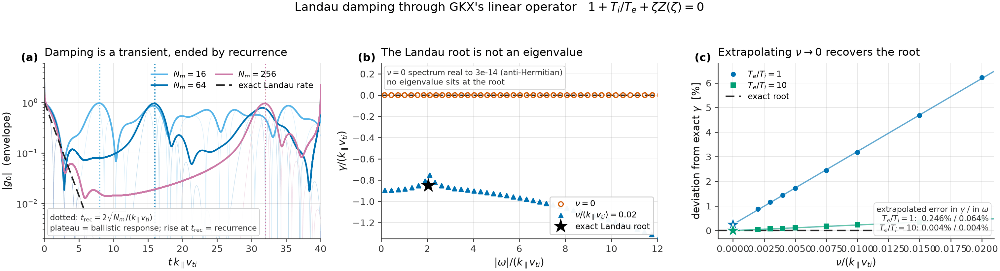

Numerics
========

This page describes how GKX discretizes and integrates the operator stated in
:doc:`operators`, the defaults a run takes when a deck leaves a choice open,
and the numerical checks behind them. Solver selection and eigenvalue
certification are covered in :doc:`solvers`.

Spectral discretization
-----------------------

Perpendicular coordinates are Fourier modes on a uniform grid in :math:`x` and
:math:`y`; the parallel coordinate is resolved in real space along the field
line, and differentiated spectrally. Velocity space uses a Hermite-Laguerre
basis. The state layout for one species is

``(N_l, N_m, N_y, N_x, N_z)``.

JAX execution model
-------------------

``jax.jit`` stages the integrators and ``jax.lax.scan`` drives the time loop.
Implicit time steps and shift-invert inner solves use ``solvax.gmres``
(right-preconditioned FGMRES); nonlinear IMEX reverse mode wraps it in
``solvax.linear_solve``, whose implicit-function VJP solves the transposed
system instead of differentiating the iterations. The Hermite line solve uses
``solvax.tridiagonal_solve``. ``solvax.chunked_jacfwd`` bounds memory for
geometry Jacobians; chunking changes batching, not the columns. Generic
algebra lives in SOLVAX (the floor is declared once, in ``pyproject.toml``);
state layout, linked-boundary assembly, preconditioner coefficients, branch
tracking, transport windows and physics gates stay in GKX. Module names are in
:doc:`design`.

Time integration algorithms
---------------------------

Linear integrators (:func:`gkx.solvers_linear_integrators.integrate_linear`)
share the cached operator data of
:func:`gkx.operators.linear.cache_builder.build_linear_cache`:

- **Explicit** ``euler``, ``rk2``, ``rk4``, ``sspx3``; **CFL-controlled**
  (``integrate_linear_explicit``), which recomputes the step from the linear
  max-frequency estimate (defaults ``rk4``, ``fixed_dt=False``, ``cfl=0.9``).
- **Diagonal IMEX** ``imex`` (first order) and ``imex2``: diagonal collision
  and hypercollision damping implicit, everything else explicit.
- **Backward Euler + GMRES** ``implicit``, with the physical preconditioner
  named in ``implicit_preconditioner``.

``imex2`` is the `ARS(2,2,2) split <https://doi.org/10.1016/S0168-9274(97)00056-1>`_.
For a diagonal non-negative damping :math:`D` and explicit remainder :math:`E`,
with :math:`\gamma=1-1/\sqrt{2}` and :math:`\delta=1-1/(2\gamma)`:

.. math::

   Y &= (I + \gamma hD)^{-1}\left(y_n + \gamma hE(y_n)\right), \\
   y_{n+1} &= (I + \gamma hD)^{-1}\left[y_n
      + h\delta E(y_n) + h(1-\delta)E(Y) - h(1-\gamma)DY\right].

It is second order and L-stable for pure damping; with :math:`D=0` its
stability polynomial is explicit midpoint's. Nonlinear runs use an explicit
scheme (``euler``, ``rk2``, ``rk3`` variants, ``rk4``, ``sspx3``, ``k10``),
``imex`` (linear operator implicit by GMRES, bracket explicit) or the opt-in
``imex-ars3`` (:doc:`guidance`). The CFL prefactor ``cfl_fac`` is 1.73 for
``rk3``/``sspx3``, 2.82 for ``rk4``, 1.0 otherwise. Reverse derivatives of the
IMEX route use the converged-system implicit derivative.

.. _first-run-defaults:

What a first run gets
---------------------

Defaults for a deck that leaves a choice open, each backed by a
load-independent measurement (:ref:`q28-defaults`):

- **Eigen route:** ``auto``, banded direct shift-invert where it fits, else
  ``adaptive``, the residual-certified propagator eigensolve (:doc:`solvers`).
- **Precision:** ``complex64``. On ``01_linear_tokamak/case_full.toml`` float32
  gives :math:`\gamma = 0.09309106` against float64's :math:`0.09309117`
  (1.2e-6 relative); ``JAX_ENABLE_X64=true`` applies the float64 certification
  gate (1e-9 against 1.19e-4) at about 17% more memory.
- **Step:** a deck that sets ``[time] dt`` keeps ``rk2`` at that step; a deck
  without ``dt`` gets ``rk4`` with the CFL controller. Fixed-step linear paths
  warn when ``dt`` exceeds the CFL estimate.
- **Resolution:** ``(Nl, Nm) = (12, 24)`` linear, ``(4, 8)`` nonlinear, a
  starting point and not a convergence statement.
- **Nonlinear horizon:** diagnosed runs stop at saturation, with ``t_max`` as
  the cap (:ref:`saturation-stop`).
- **Unchanged:** two-thirds dealiasing; ``collisions`` and ``hypercollisions``
  enabled as terms with per-species ``nu = 0``; the persistent compilation
  cache on, so a second run skips compilation; the CPU FFT thread pool stays
  on (single-threaded measured 8--10% slower).

.. _q28-defaults:

Measurements behind the defaults
--------------------------------

Shipped Cyclone deck, float32, counting propagator applies, steps and
right-hand-side evaluations rather than wall time.

.. list-table::
   :header-rows: 1
   :widths: 30 20 50

   * - default
     - value
     - accuracy
   * - ``KrylovConfig.power_iters``
     - 40
     - residual 9.50e-01; 200 applies give 9.47e-01; neither certifies
   * - ``TimeConfig`` pairing when the deck chose no ``dt``
     - rk4, CFL-controlled
     - -2.63e-04 relative to the certified eigensolve
   * - ``Nl``/``Nm`` linear fallback
     - (12, 24)
     - +0.400% of the tracked GX golden

**power_iters.** At (4, 8), ``ky = 0.3`` the power ladder stalls near a residual
of 6e-3 (5000 applies) against the 1.19e-4 gate, so no count certifies and 40
is chosen for cost. No shipped deck selects the power route, and with
``certify=True`` it raises rather than return an uncertified pair.

**Time pairing.** The defaulted ``dt = 0.1`` is 7.8x the CFL-stable 0.01281, so
fixed-step rk2 and rk4 overflow. With the controller, rk2, rk3 and rk4 agree
within 3e-4 and rk4 needs 29.1% fewer right-hand-side evaluations (11072
against 15612 for rk2), exactly :math:`4/(2.82\times2)`. A deck that chooses
``dt`` keeps rk2, and every shipped deck sets ``dt``.

**Resolution.** Certified eigensolves at ``ky = 0.3`` against the GX golden
:math:`\gamma = 0.09302951`:

====  ====  ==========  ==============
Nl    Nm    gamma       rel. to golden
====  ====  ==========  ==============
8     24    0.09877566  +6.177%
24    12    0.08893196  -4.405%
12    24    0.09340143  **+0.400%**
12    32    0.09263792  -0.421%
16    32    0.09284505  -0.198%
24    24    0.09368346  +0.703%
16    48    0.09309106  +0.066%
====  ====  ==========  ==============

All rungs certify at the 1.19e-4 gate. The ladder is not monotone, so
(12, 24) is where this case lands at that cost, not an error bound for another
case. Parallel phase mixing needs Hermite resolution while the FLR response
needs enough Laguerre; a deck whose physics runs the other way, such as the
ETG decks at ``Nl = 24``, ``Nm = 8``, says so.

.. _saturation-stop:

Saturation stop policy
----------------------

A diagnosed nonlinear run with ``run_to = "saturation"`` (the default)
integrates in chunks and asks
:func:`gkx.diagnostics.saturation.saturation_stop_decision` after each whether
the heat-flux trace supports a mean. It stops when every gate passes, or at
``t_max``, without claiming saturation. Spin-up is removed up to the first
crossing of the trace's own median. The window mean's standard error uses the
Sokal integrated autocorrelation time :math:`\tau`:
:math:`\mathrm{SEM} = s/\sqrt{n_\mathrm{eff}}`,
:math:`n_\mathrm{eff} = \min(n,\; n\,\Delta t/(2\tau))`. All of these must hold:

.. list-table::
   :header-rows: 1
   :widths: 34 66

   * - Gate (reason recorded when it fails)
     - Condition
   * - ``tau_ac_unresolved``
     - the autocorrelation crosses zero inside the window and :math:`\tau > \Delta t`
   * - retained samples
     - at least 256 after spin-up
   * - ``window_below_min_window``
     - window span at least :math:`20\tau` and ``saturation_min_window``
   * - ``rel_sem_above_threshold``
     - :math:`\mathrm{SEM}/|\text{mean}| \le` ``saturation_rel_sem`` (0.05)
   * - ``window_not_stationary``
     - first- and second-half means agree within twice their combined SEM
   * - ``guard_not_stationary``, ``Wg_guard_not_stationary``
     - the same half-window test for ``Wphi`` and ``Wg``
   * - ``flux_indistinguishable_from_zero``
     - :math:`|\text{mean}| > 10^{-9}`

These are finite-sample safeguards, not a sequential-confidence guarantee, and
are not qualified for irregular adaptive sampling. The decision and its
reasons are written under ``saturation`` in the summary JSON. A prepared
simulation (``gkx.prepare``) compiles a fixed length, so it refuses
``run_to = "saturation"`` unless given ``steps=N``.

Distributed state sharding
--------------------------

``TimeConfig.state_sharding = "auto"`` (or ``"ky"``/``"kx"``) partitions the
packed nonlinear state over several JAX devices; with one device it is ignored.
``"z"`` is rejected (the FFT-axis decomposition has not passed its identity
gate) and the sharded path refuses a non-default ``collision_operator``. Active
multi-device CPU sharding is skipped on macOS because XLA CPU FFT layouts can
abort. A speedup claim needs its own identity, transport-window and profiler
gates.

Nonlinear FFT bracket
---------------------

The :math:`E\times B` term is pseudospectral. By default
(``compressed_real_fft = true``) gradients come from the ``N_y/2+1``
non-negative-:math:`k_y` spectrum, matching the reference layout and minimizing
memory traffic. Electromagnetic runs stack ``J0*phi``, ``J0*apar`` and the
``bpar`` correction into one FFT batch.

*Limitation (#336).* The ``"grid"`` Laguerre bracket advects with the node-space
:math:`J_0\phi` and keeps the first ``Nl`` coefficients, while quasineutrality
uses the analytic :math:`J_\ell`. The retained energy is then conserved only to
about :math:`7\times10^{-8}` of the bilinear scale at ``Nl = Nm = 4``. Treat
it as a resolution diagnostic, converged in ``Nl`` (Mandell, Dorland &
Landreman 2018, section 4.1).

The ``ky`` layout contract
--------------------------

:mod:`gkx.core_ky_layout` owns every conversion between two layouts of the
``ky`` axis. ``full`` is the two-sided ``fftfreq`` order with ``Nky = Ny``; the
runtime evolves it. ``half`` is the non-negative ``rfftfreq`` rows,
``Nyc = 1 + Ny // 2``; GX, stella and GS2 evolve it, and GKX uses it for
restarts, NetCDF output, spectra and snapshots. A real field obeys
:math:`F(-k_y, -k_x, z) = F^{*}(k_y, k_x, z)`. Three rules:

- ``Nyc`` does not determine ``Ny``: widening takes ``ny_full`` explicitly.
- Row 0, and row ``Ny/2`` for even ``Ny``, are self-conjugate:
  :math:`F(k_x) = F^{*}(-k_x)` within the row. Storing ``ky >= 0`` does not
  enforce it; operators that write those rows call
  ``symmetrize_self_conjugate_rows``.
- Reductions of quantities even in :math:`k_y` use
  ``ky_row_weights`` (2 on paired rows, 1 on self-conjugate rows), never a
  blanket factor of two, which over-counts the Nyquist row. A flux on that row
  vanishes for a real field, and two-thirds dealiasing zeroes it anyway.

``[grid] ky_layout = "half"`` is the default; ``"full"`` is the opt-out. On
Cyclone at ``24x24x24`` to ``64x64x24`` the two layouts agree to 2e-16 (x64) and
2e-7 (float32) in the nonlinear diagnostics, with even and odd ``Nyc``, with
``state_sharding = "ky"`` on four forced CPU devices, and bitwise in the
heat-flux window value and gradient; ``"half"`` runs the window gradient in 0.68
(CPU) to 0.72 (GPU) of the two-sided time (:doc:`performance`).

Equilibrium-flow shearing coordinates
-------------------------------------

A research path, not an input option.
:func:`gkx.operators.nonlinear.projection.advance_shearing_coordinates`
follows :math:`k_x^*(t) = k_x(0) - k_y\gamma_E t`. When the displacement
crosses half a radial cell the state moves to the nearest :math:`k_x`, the
sub-cell residual is kept in the wavenumber and the phase
:math:`\exp(i\,\delta k_x x)` (the corrected remap of [McMillan19]_), and
modes leaving the two-thirds band are zeroed. The remap is piecewise constant
with a stopped tangent; wavenumbers and phases stay differentiable between
remaps. Non-twist tubes are refused. There is no parallel-velocity-gradient
drive [Schekochihin12]_ [Ball19]_. Shear is expected to decorrelate turbulence
once the shearing rate exceeds the instability rate [Biglari90]_ [Waltz95]_;
the gate below tests that. Integrators:
``integrate_nonlinear_sheared`` (RK2, RK3, fixed-step IMEX) and
``integrate_nonlinear_sheared_transport``. Treatment effects are judged with
``matched_nonlinear_transport_report``, not by comparing two chaotic traces.

**The response gate fails, so flow shear stays out of input files.**
``docs/_static/flow_shear_fixed_step_response_gate.json`` (Cyclone ITG,
``64x64x24``, ``Nl=4``, ``Nm=8``, ``dt = 0.02``, window :math:`t = [240, 300]`):

.. list-table::
   :header-rows: 1
   :widths: 30 25 25 20

   * - integrator
     - :math:`\gamma_E = 0`
     - :math:`\gamma_E = 0.01`
     - windows pass
   * - GKX fixed-step IMEX
     - 15.451 ± 0.263
     - 16.195 ± 0.160
     - no
   * - independent fixed-step RK4
     - 11.715 ± 0.216
     - 14.624 ± 0.141
     - yes

Both increase the heat flux (4.82% and 24.82%) instead of the required 5%
reduction at two combined SEMs, which rejects the weak-shear suppression claim.
The coordinate, remap, operator and derivative identities are not rejected.

.. _end-damping:

Parallel boundary and end damping
---------------------------------

A linked (twist-and-shift) chain is a finite piece of the infinite ballooning
line. Its spectral :math:`z` derivative is periodic over the chain, so what
streams out of one end would re-enter at the other. GKX absorbs it in a layer
at each end of every non-zonal chain:

.. math::

   \partial_t h \;\mathrel{+}= -\nu_{end}\, d(z)\, h, \qquad
   d = 1 - \frac{2x^2}{1 + x^4},\quad x = \frac{\text{distance from the chain end}}{L_w},

with :math:`L_w` = ``damp_ends_widthfrac`` (0.125) of the chain. The damped
quantity is the non-adiabatic :math:`h`, as in GX.

**Contract.** :math:`\nu_{end}` is a rate in :math:`v_{ti}/a` units and the
same on every route: time integration (any step, fixed or adaptive), Krylov,
eigen, shift-invert and nonlinear. No timestep enters. ``[time]
damp_ends_rate`` sets it. The default is

.. math::

   \nu_{end} = C\,\frac{\max_s v_{ts}\,|\hat b\cdot\nabla z|}{w\,L_z},\qquad C = 30,

that is, 30 e-folds per thermal transit of the fastest kinetic species across a
layer of one segment (:math:`L_z` is the stored :math:`z` extent). Each run
prints the rate it uses (``end damping: rate ...``). A deck that sets only the
legacy ``damp_ends_amp`` is refused.

**Why a rate.** GX applies ``damp_ends_amp/dt`` (before February 2023,
:math:`5 v_{max}/L`). Read as a rate, :math:`A/\Delta t` makes a timestep-free
eigenvalue depend on a step it does not have. GS2 [KRT95]_ and stella [BPL19]_
need no absorber (upwinded implicit streaming sets :math:`h = 0` for incoming
particles); GENE truncates the :math:`k_x` connection and uses parallel
hyperdiffusion [PDJ10]_. A Hermite basis does not separate :math:`v_\parallel`
directions, so GKX keeps GX's layer and fixes only its units.

**Measured sensitivity** (ky 0.3; ``plan/research/2026-10-15-end-damping``;
:math:`\gamma` in deck units):

.. list-table::
   :header-rows: 1

   * - deck (Nl, Nm), route
     - nperiod
     - C = 3
     - C = 10
     - C = 30
     - C = 100
   * - adiabatic Cyclone (8, 16), Krylov
     - 2 / 3 / 4
     - 0.09825 / 0.09831 / 0.09831
     - 0.09829 / 0.09831 / 0.09831
     - 0.09831 / 0.09831 / 0.09831
     - 0.09825 / 0.09831 / 0.09831
   * - kinetic-electron Cyclone (8, 16), time
     - 2
     - 0.16786
     - 0.16792
     - 0.16803
     - 0.16807
   * - KBM s-alpha (4, 8), sparse eigen
     - 2 / 3
     - 0.2364 / 0.2382
     - 0.2441 / 0.2497
     - 0.2426 / 0.2502
     - 0.2407 / 0.2499

Below :math:`C \approx 1` the kinetic-electron and KBM rates are not converged
(KE :math:`\gamma` = 1.59 at C = 0, 0.174 at C = 1). Kinetic electrons at
(8, 16) are not converged in domain length (nperiod 3 gives 0.288); that is a
resolution question, not an absorber one. At ``nperiod = 1`` the layer is a
quarter of the line and the adiabatic rate keeps falling with C
(0.0923 at C = 10, 0.0817 at C = 300): use ``nperiod >= 2``.

**Explicit steps.** :math:`\nu_{end}` is explicit, so :math:`\nu_{end}\Delta t`
must stay inside the scheme's stability region. It is below 0.3 on the shipped
``nperiod >= 2`` linear decks; an ``nperiod = 1`` KBM deck (rate 598)
blew up at :math:`\Delta t = 10^{-3}` and runs at :math:`5\times10^{-4}`. The
CFL estimate does not yet include :math:`\nu_{end}`.

**Checking a result.** Rerun at ``damp_ends_rate`` 3x above and below the
printed rate and at ``nperiod + 1``. A converged growth rate moves by less
than its quoted tolerance in all three.

.. [KRT95] M. Kotschenreuther, G. Rewoldt, W. M. Tang, Comput. Phys. Commun. 88, 128 (1995).
.. [BPL19] M. Barnes, F. I. Parra, M. Landreman, J. Comput. Phys. 391, 365 (2019).
.. [PDJ10] M. J. Pueschel, T. Dannert, F. Jenko, Comput. Phys. Commun. 181, 1428 (2010).

De-aliasing and hyperdiffusion
------------------------------

Nonlinear brackets use the standard ``2/3`` de-alias mask, stored on the
spectral grid and applied inside the bracket. Perpendicular hyperdiffusion
(``D_hyper``, ``p_hyper_kperp`` and the ``hyperdiffusion`` term weight; see
:doc:`operators`) is available as scale-selective damping and is off by
default. :math:`k_{\perp,\max}` is taken from the full grid's dealiased corner,
also when a linear run keeps only a subset of ``ky`` rows.

Linear solver options
---------------------

- **Batched ``ky`` scans:** ``ky_batch>1`` integrates several ``ky`` at once;
  ``fixed_batch_shape=True`` pads the last batch to avoid recompiling.
- **Implicit preconditioners** (``implicit_preconditioner``): ``"auto"``/
  ``"diag"``/``"physics"``/``"block"``, ``"damping"``, ``"pas"``,
  ``"pas-coarse"``, ``"hermite-line"``, ``"hermite-line-coarse"``,
  ``"identity"``.
- **Shift-invert preconditioners** (``KrylovConfig.shift_preconditioner``):
  ``"damping"``; ``"hermite-line"`` (FFT in :math:`z` plus a tridiagonal
  Hermite solve of the diagonal-plus-streaming symbol, :math:`O(n)`);
  ``"field-corrected"`` (the line plus the exact field response by a Woodbury
  capacitance solve); ``"pr3-cm"`` (below). ``"auto"`` is ``"pr3-cm"`` with the
  inner FGMRES raised to restart 150 and maxiter 600 (:doc:`algorithms`).
- **Acceptance:** every shift-invert pair is checked against the matrix-free
  relative residual
  :math:`\lVert Av-\lambda v\rVert/\max(\lVert Av\rVert,|\lambda|\lVert v\rVert)`
  with ``shift_outer_residual_tol`` (``1e-6``); rejected pairs raise. The
  eigenvalue is refreshed as the physical Rayleigh quotient.
- **Branch selection:** ``KrylovConfig.mode_family`` (``"cyclone"``, ``"etg"``,
  ``"kbm"``) and ``shift_selection``; ``fallback_method`` defaults to
  ``"propagator"``. Retained-Ritz thick restarts, projected Jacobi--Davidson
  and reduced Schur complements were tried for interior KBM eigenpairs, all
  chose the wrong branch, and none is shipped.
- **Reusable IMEX operators:** ``build_nonlinear_imex_operator`` prebuilds the
  matrix-free operator for ``integrate_nonlinear_imex_cached``.

The inner solves are right-preconditioned FGMRES started from zero. On the
first right-hand side of the outer Arnoldi (Cyclone, ``(Nz, Nl, Nm) = (96, 4,
8)``, float64) three GMRES(20) cycles from zero leave relative residuals of
0.995 (``hermite-line``), 0.9995 (``field-corrected``), 0.86 (``damping``) and
0.299 (``pr3-cm``); only ``pr3-cm`` converges unrestarted (9.9e-5 in 252
iterations), so raise ``shift_restart`` and ``shift_maxiter`` together.

``pr3-cm`` (``solvers_linear_precond_pr3.py``) splits the operator into two
halves, each invertible in closed form, and sweeps between them. The Hermite
line solve inverts streaming, hypercollisions and the *z*-mean of the drift.
The rest (exact :math:`\omega_d(z)`, mirror, drive, end damping, collisions,
local field response) is *z*-local: dense :math:`(l, m)` blocks per
``(species, ky, kx, z)``. One Peaceman--Rachford double sweep costs one solve of
each and no operator application; ``pr3-cm`` is three sweeps from zero, with
:math:`\alpha = -\sqrt{s_1 d}` unless ``shift_precond_alpha`` is set. The
*z*-local block is solved by block-Thomas elimination in the Laguerre index plus
a Sherman--Morrison correction for the rank-one field part
(``solvax.block_thomas_factor_ops``), 1.5x to 2.7x smaller than a dense-band
factor. If the block is not *l*-tridiagonal, ``shift_precond_block_solve =
"auto"`` falls back to the dense batched inverse and records why; the build
also checks that the non-streaming operator is *z*-local and refuses otherwise
(zonal rows under adiabatic electrons fail it).

Automatic solver and fit-signal selection
-----------------------------------------

``solver = "auto"`` (default) runs the time path and falls back to the Krylov
eigensolve when the fitted ``(gamma, omega)`` is non-finite or violates
``require_positive``. ``fit_signal = "auto"`` fits both the ``phi`` and density
traces with the same windowing rules and keeps the higher score. Set
``solver = "time"``, ``"explicit_time"`` or ``"krylov"`` and ``fit_signal =
"phi"`` or ``"density"`` to override.

Custom collision operators
--------------------------

Shipped models and the Python protocol are in :doc:`operators`. A custom
operator is any JAX-compatible object with ``apply(context)``, passed as
``collision_operator=`` to ``linear_rhs``, ``linear_rhs_cached``,
``integrate_linear`` or ``nonlinear_rhs_cached``. It runs on serial explicit and
IMEX linear integration and serial explicit nonlinear integration; implicit
linear solves, nonlinear IMEX, sheared IMEX and decomposed integration refuse
it. The finite-Larmor-radius coefficients are cancellation-sensitive, so they
are generated offline in multiple precision with their provenance and loaded as
compact arrays. Frei, Hoffmann & Ricci write the Bessel argument as
:math:`B=k_\perp\sqrt{2\tau}`; the runtime interpolates at :math:`B=\sqrt{2b}`.
Evidence files are ``docs/_static/collision_*.json``.

Landau damping against the exact kinetic roots
----------------------------------------------

The slab ion-acoustic dispersion relation with adiabatic electrons at
:math:`k_\perp \to 0`,

.. math::

   1 + \frac{T_i}{T_e} + \zeta Z(\zeta) = 0,
   \qquad
   \zeta = \frac{\omega}{k_\parallel \sqrt{2T_i/m_i}},

with :math:`Z` the plasma dispersion function (``scipy.special.wofz``), has no
free parameters. ``test_landau_root_recovered_by_collisional_extrapolation``
evolves the production operator at :math:`N_m = 64` and requires the
:math:`\nu \to 0` extrapolation within 1% in :math:`\gamma` and 0.5% in
:math:`\omega` of the root, at :math:`T_e/T_i = 1` and 10.

   Produced by ``linear_rhs_cached``; panel (b) eigen-decomposes the same
   operator.

Four traps give plausible but wrong numbers (all gated in
``tests/validation/physics_gates/test_collision_physics.py``):

1. A collisionless truncated Hermite system cannot Landau damp: free streaming
   is anti-Hermitian, so the spectrum is real (:math:`\max|\mathrm{Re}\,\lambda|
   < 10^{-11}`) and any fitted rate is a transient that ends at recurrence.
2. The Landau root is a pole of the continued response, not an eigenvalue. Add
   collisions, measure the decay at several small :math:`\nu`, extrapolate.
3. A density perturbation with no flow is a standing wave; fit
   :math:`A e^{\gamma t}\cos(\omega t + \phi)`, not an unwrapped phase.
4. ``tau_e`` is :math:`T_i/T_e`; the reciprocal is invisible at :math:`T_e=T_i`.
   GKX normalizes to :math:`v_{ti}=\sqrt{T/m}`, not :math:`\sqrt{2T/m}`.

Hermite closure and recurrence
------------------------------

Terminating the ladder with :math:`G_{M+1} = 0` is a reflecting boundary: free
energy returns to the low moments as recurrence at
:math:`t_{\mathrm{rec}} \simeq 2\sqrt{M}/(k_\parallel v_{th})`. Because that
grows only as :math:`\sqrt{M}`, the end of the ladder must absorb. GKX has two
treatments.

**Hypercollisions** (default, ``[physics] hypercollisions = true``) damp a band
of high moments with the :math:`|k_z|`-scaled branch
:math:`\propto \nu_{hyper,m}|k_z|(m/M)^{p_m}` (``nu_hyper_m``, ``p_hyper_m``;
:doc:`operators`).

**Reflectionless closure** (opt-in, Python API
``hermite_closure="reflectionless"``) applies the outgoing-wave condition of
Kanekar et al., *J. Plasma Phys.* **81**, 305810104 (2015), Eq. (4.36):

.. math::

   G_{M+1} = -\,i\,\mathrm{sgn}(k_\parallel)\,R_{M+1}\,G_M,
   \qquad
   R_{M+1} = \frac{M}{\sqrt{2(M+1)}}
             \frac{\Gamma(M/2)}{\Gamma\!\left((M+1)/2\right)},

a single sink :math:`-R_{M+1}\sqrt{M+1}\,v_{th}|k_\parallel|\,G_M` on the last
moment. :math:`R_{M+1} \to 1 - 1/(4M)`, so the absorption becomes exact with
resolution; :math:`R_{M+1} > 0` makes it a positive-definite energy sink; and it
touches only :math:`m = M`. At :math:`M = 2` it reduces to the Hammett-Perkins
three-pole coefficient 0.921318. The test
``test_absorbing_closures_beat_truncation_on_both_metrics`` requires each
treatment to cut the revived :math:`|g_0|` below a tenth of truncation's and
to keep the pre-recurrence error below 0.1, since suppression alone rewards any
strong damping. It carries no free parameter but is not a drop-in replacement
for a tuned hypercollision.

Operator assembly
-----------------

Equations are in :doc:`operators`. ``LinearTerms`` toggles convert to one
``TermConfig`` (``linear_terms_to_term_config``), and
``gkx.terms.assemble_rhs_cached`` sums the per-term kernels; the same RHS serves
the linear integrators, Krylov applications and nonlinear IMEX solves.
``LinearParams.rho_star`` scales the perpendicular wavenumbers in the drift and
drive terms without changing the FFT spacing.

Nodal magnetic-moment grid
--------------------------

``[run] mu_vperp_max`` (``LinearParams.mu_vperp_max``) replaces the Laguerre
expansion in :math:`\mu B` by values at the nodes of a quadrature rule in the
fixed variable :math:`\hat\mu=\mu B_0`; ``Nl`` is then the number of nodes.
The default (unset) is the Laguerre path, bitwise unchanged. The nodes and
weights :math:`w_j` are those of the rule for the weight :math:`e^{-\hat\mu}` on
:math:`[0, v_{\perp,\max}^2/2]` (``vperp_max = 4`` is the usual choice;
``inf`` gives Gauss-Laguerre). Hermite stays spectral. At node :math:`j` and
position :math:`z`, with :math:`x_j=\mu_j B(z)=\hat\mu_j B/B_0`,

.. math::

   g(v_\parallel,\hat\mu_j,z)=S_j(z)\sum_m\phi^m(v_\parallel)\,G_m(\hat\mu_j,z),
   \qquad S_j=e^{-x_j/2}.

With the half Maxwellian factored out, the parallel advection at fixed
:math:`\mu` becomes

.. math::

   \big(\mathcal L_\parallel H\big)_m=\sqrt{m+1}\,\nabla_\parallel H_{m+1}
   +\sqrt m\,\nabla_\parallel H_{m-1}
   +\tfrac{x_j}{2}\nabla_\parallel\ln B\,\big[\sqrt m\,H_{m-1}-\sqrt{m+1}\,H_{m+1}\big],

so the mirror coupling is local to the node and antisymmetric in :math:`m`.
:math:`\int dz\,S_jG_{j,0}` is conserved by streaming plus mirror. The other
terms are evaluated per node: the grad-B drift multiplies by :math:`x_j`, the
diamagnetic drive is :math:`\omega_*J_j\,[L_n^{-1}+(x_j-1)L_T^{-1}]` at :math:`m=0`
(and :math:`L_T^{-1}/\sqrt2` at :math:`m=2`, as in the Laguerre path),
and the gyroaverage is
:math:`J_0(\alpha_j)`, :math:`2x_jJ_1(\alpha_j)/\alpha_j` with
:math:`\alpha_j^2=2x_j k_\perp^2\rho^2` at the local field. Fields are quadrature
sums with weights :math:`(B/B_0)\,w_je^{\hat\mu_j-x_j/2}` for the evolved
moments and :math:`(B/B_0)\,w_je^{\hat\mu_j-x_j}` for the Maxwellian
response :math:`\Gamma_0`.

The state stored in the Laguerre slot is :math:`a_jG_{j}` with
:math:`a_j=\sqrt{(B/B_0)\,w_je^{\hat\mu_j}}`. The two weights above then
become the single array :math:`J_j=a_jS_jJ_0(\alpha_j)` that the Laguerre field
solve, Hamiltonian view and streaming already use, and the :math:`\nabla_\parallel`
of the scaled amplitude adds :math:`\tfrac12\nabla_\parallel\ln B` to the mirror
coefficients, which become :math:`(x_j\pm1)/2`.

Scope: linear runs, electrostatic and electromagnetic (:math:`A_\parallel`,
:math:`B_\parallel`). Collisions, ``nu_hyper``, ``nu_hyper_l``, ``nu_hyper_lm``
and ``hypercollisions_const`` are refused (a collision operator on exponentially
stiff fixed-:math:`\hat\mu` nodes needs a weak-form matrix; the :math:`|k_z|`
Hermite hypercollisions are unchanged). Nonlinear runs are refused. The seed
``init_field`` writes ``l = 0``, i.e. the first node. Velocity-space diagnostics
that assume Laguerre moments are not defined for the scaled node amplitudes.
