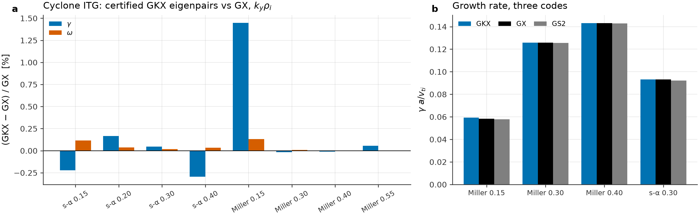

Validation
==========

Every public number in GKX has one row in the evidence ledger,
``tools/evidence_ledger.toml``; the coverage manifest lists every source
module. Coverage is a guardrail: a test counts when it protects an equation, a
numerical method, a diagnostic convention, an artifact contract or an autodiff
guarantee. A row's status is ``passing``, ``provisional``, ``open``,
``failing`` or ``superseded``; a ``provisional`` row states what is
unresolved. Benchmark figures and cross-code comparisons follow the matrix.

Evidence ledger
---------------

``tools/evidence_ledger.toml`` has one ``[[row]]`` per public number or claim,
with ``id``, ``claim``, ``observable``, ``artifact``, ``generator``,
``reference``, ``reference_rank`` (1 analytic; 2 published; 3 reference-code
golden; 4 open dataset; 5 self-run), ``tier`` (0 on push under 60 s; 1 on push,
bitwise; 2 nightly physics; 3 campaign or GPU) and ``status``. A claim cites the
highest-ranked reference available; a self-run reference is rank 5 and never
described as published. ``tests/release/test_release_gates.py`` enforces:

- required keys and valid rank, tier and status; artifacts and generators exist;
- a ``provisional`` row has ``notes`` saying what is unresolved;
- a rank-3 row pins its reference file with ``reference_sha256``, and
  linked-boundary GX references record their end-damping clamp state;
- the README parity table and the ledger list the same cases, and each README
  percentage recomputes from its artifact as ``100 max|gkx - ref| / max|ref|``;
- every linear row declares its velocity-space regularization, and a
  collisionless row with no Laguerre-space sink reports its velocity limit.

Claim scope
-----------

A passing test or a covered line does not promote a claim: the artifact must
record the observable, reference, tolerance and accepted claim level.
:doc:`release_scope` is the human-readable claim ledger and stays in step with
``benchmarks/references/gkx_1_7_release_contract.json``. An example that runs is
a release claim only when labeled release-gated and tied to its artifact.

Coverage manifest
-----------------

``tools/validation_coverage_manifest.toml`` gives each module a source path,
owning lane, reference anchors, physics and numerics contracts, fast tests,
artifacts and next tests (ownership rules in :doc:`design`).
``scripts/checks/check_validation_coverage_manifest.py`` checks structure and
paths; with ``--coverage-xml ... --enforce-package-coverage`` it fails below the
95% package target, and ``gate-index`` writes
``docs/_static/validation_gate_index.json``. :doc:`testing` gives the current
result.

Verification matrix
-------------------

The ledger table below is generated from the ledger, and the release gates
fail when they disagree. The last part lists lanes that have artifacts but no
ledger row; they are not public claims.

.. BEGIN LEDGER MATRIX (generated by the retired scripts/validation_matrix.py; keep in step with tools/evidence_ledger.toml)

Ledger ``tools/evidence_ledger.toml``, schema 1, updated 2026-10-07: 21 rows, 10 provisional, 1 open, 10 passing.

Ledger rows
-----------

*Measured* for the linear parity rows is ``100 max|gkx - ref| / max|ref|`` over the tracked scan, recomputed from the artifact. Reference ranks: 1 analytic; 2 published; 3 reference-code golden; 4 open dataset; 5 self-run.

.. list-table::
   :header-rows: 1
   :widths: 12 18 16 26 8 20

   * - ID
     - Claim
     - Measured
     - Reference (rank)
     - Status
     - Artifact
   * - ``L-lin-kaw``
     - README linear parity table, KAW
     - gamma 0.0004%, omega 0.051%
     - analytic kinetic-Alfven-wave dispersion; GX benchmarks/linear/KAW golden retained as a cross-check (rank 1)
     - passing
     - ``docs/_static/kaw_exact_growth_dump.csv``
   * - ``L-lin-etg``
     - README linear parity table, ETG
     - gamma 0.040%, omega 0.074%
     - GX ETG comparison scan generated by this campaign (rank 5)
     - passing
     - ``docs/_static/etg_mismatch_table.csv``
   * - ``L-lin-w7x``
     - README linear parity table, W7-X
     - gamma 0.265%, omega 0.296%
     - GX benchmarks/linear/ITG\_w7x, run by this campaign; upstream ships the deck and eik but no \*\_correct.out.nc (rank 5)
     - passing
     - ``docs/_static/w7x_linear_t2_scan.csv``
   * - ``L-lin-hsx``
     - README linear parity table, HSX
     - gamma 0.577%, omega 0.273%
     - GX output supplied through the unrecorded HSX\_IMPORTED\_ARGS environment variable (rank 5)
     - provisional
     - ``docs/_static/hsx_linear_t2_scan.csv``
   * - ``L-lin-cyclone-miller``
     - README linear parity table, Cyclone Miller
     - gamma 5.51%, omega 1.25%
     - GX benchmarks/linear/ITG\_cyclone/itg\_miller\_adiabatic\_electrons\_correct.out.nc (rank 3)
     - provisional
     - ``docs/_static/cyclone_miller_linear_mismatch.csv``
   * - ``L-lin-cyclone-salpha``
     - README linear parity table, Cyclone ITG
     - gamma 6.83%, omega 1.59%
     - GX benchmarks/linear/ITG\_cyclone/itg\_salpha\_adiabatic\_electrons\_correct.out.nc (rank 3)
     - provisional
     - ``docs/_static/cyclone_mismatch_table.csv``
   * - ``L-lin-kbm``
     - README linear parity table, KBM
     - gamma 20.0%, omega 11.1%
     - GX benchmarks/linear/KBM/kbm\_miller\_correct.out.nc (rank 3)
     - provisional
     - ``docs/_static/kbm_mismatch_table.csv``
   * - ``F-landau-damping``
     - Landau damping against the exact roots of 1 + T\_i/T\_e + zeta Z(zeta) = 0
     - relative error of the extrapolated GKX root against the exact root
     - analytic plasma dispersion function roots (rank 1)
     - passing
     - ``docs/_static/landau_damping_validation.png``
   * - ``F-collision-verification``
     - collision operator coefficients, invariants and projections in an eight-moment basis
     - conservation, self-adjointness and published-coefficient residuals
     - Frei, Ernst & Ricci (2022) Appendix C closed forms (rank 2)
     - passing
     - ``docs/_static/collision_operator_verification.json``
   * - ``F-nonlinear-autodiff``
     - checkpointed nonlinear window derivative against centered finite differences, and its memory
     - AD/FD relative agreement versus window length; measured temporary state
     - centered finite differences on the same detached state and discrete map (rank 1)
     - passing
     - ``docs/_static/nonlinear_autodiff_validation.png``
   * - ``F-runtime-memory``
     - README performance figure: cold wall time and peak memory across tracked cases
     - cold wall time and peak resident set size per case and backend
     - self-measured on named hardware; not a cross-code speed claim (rank 5)
     - passing
     - ``docs/_static/runtime_memory_benchmark.png``
   * - ``F-saturation-policy``
     - the stopping policy replayed on three tracked runs, each stopped by a different gate
     - stop time as a fraction of t\_max, and the binding gate
     - replay of tracked runs under the shipped policy (rank 5)
     - provisional
     - ``docs/_static/saturation_examples.png``
   * - ``F-qa-transport``
     - QA shape optimization through turbulence: initial and candidate equilibria, and matched heat-flux traces
     - heat-flux reduction across nominal pairs with its conditional interval
     - matched paired GKX runs; no external reference (rank 5)
     - provisional
     - ``docs/_static/qa_transport_reduction.svg``
   * - ``F-qa-equilibria``
     - initial and candidate QA boundaries and Boozer contours
     - boundary shape, aspect ratio, mean iota and QA residual
     - VMEX equilibria solved for this campaign (rank 5)
     - passing
     - ``docs/_static/qa_transport_equilibria.png``
   * - ``A-zonal-residual``
     - README Analytic benchmarks: zonal residual against Xiao-Catto within 2.4% on circular cases
     - fitted phi\_inf / Xiao-Catto closed form
     - Rosenbluth & Hinton PRL 80 724 (1998); Xiao & Catto PoP 13 082307 (2006) (rank 1)
     - passing
     - ``docs/_static/analytic_benchmarks.json``
   * - ``A-gam``
     - README Analytic benchmarks: GAM frequency within 3.5% of the Sugama-Watanabe root
     - fitted omega\_G and gamma\_G / root of SW Eq. (2.7) at the run's k\_x
     - Sugama & Watanabe JPP 72 825 (2006) (rank 1)
     - provisional
     - ``docs/_static/analytic_benchmarks.json``
   * - ``A-kbm-pkj``
     - README Analytic benchmarks: Cyclone KBM onset 1.04% against GENE 1.14%
     - zero of the linear gamma(beta) fit through the three lowest unstable betas, ky 0.2
     - Pueschel, Kammerer & Jenko PoP 15 102310 (2008) (rank 2)
     - provisional
     - ``docs/_static/analytic_benchmarks.json``
   * - ``A-kbm-strong-drive``
     - README Analytic benchmarks: strongly driven KBM omega\_r / (omega\_\*pi/2) = 1.06-1.10 (s-alpha)
     - omega / (ky (fprim + tprim)/2) at beta 1.5%, R/L\_T 35 and 15
     - Tang, Connor & Hastie NF 20 1439 (1980); Aleynikova & Zocco PoP 24 092106 (2017) (rank 1)
     - provisional
     - ``docs/_static/analytic_benchmarks.json``
   * - ``X-cyclone-repaired-gx``
     - Cyclone ITG adiabatic, s-alpha and Miller: certified GKX eigenpairs against the clamp-repaired GX goldens and converged GS2/gyaradax
     - relative gamma difference per ky, GKX Nl16/Nm48 certified Krylov eigenpair vs GX rerun with the dampEnds\_linked grid-stride fix (s-alpha ky .15/.20/.30/.40, Miller .15/.30/.40/.55) and vs GS2 r3/r4 (Miller .15/.30/.40/.55, s-alpha .30) and gyaradax g2 (s-alpha .30)
     - GX 3865a537 + dampEnds\_linked grid-stride loop (self-run, sha256 96a53403...); GS2 8.2.1; gyaradax 8d9dc2d2 (rank 5)
     - passing
     - ``docs/_static/cross_code_linear_points.csv``
   * - ``X-ke-miller``
     - Cyclone Miller with kinetic electrons (m\_e/m\_i 2.7e-4, beta 1e-5, A\_par), linear: GKX certified eigenpairs against repaired GX and GS2
     - relative gamma and omega difference at ky .30 and .50, GKX Nl16/Nm48 with damp\_ends\_rate 160.6 (GX's 0.1/dt at its settled dt 6.228e-4)
     - GX 3865a537 + dampEnds\_linked grid-stride loop (self-run, t = 40); GS2 8.2.1 rung e3 (ntheta 48, nperiod 3, negrid 16, ngauss 8) (rank 5)
     - provisional
     - ``docs/_static/cross_code_linear_points.csv``
   * - ``X-tem-dj2005``
     - Collisionless TEM, Dannert & Jenko PoP 12 072309 (2005) nominal case, linear: GKX against GS2 at matched physics
     - relative gamma and omega difference at ky rho\_s 0.3 along a GKX (Nl, Nm) ladder with the banded eigensolver; GKX (8, 32) scan ky rho\_s 0.2-0.6 against GS2; end-damping rate and parallel-domain scans
     - GS2 8.2.1 rungs t1 (ntheta 32, nperiod 2, negrid 12, ngauss 6) and t2 (ntheta 48, nperiod 3, negrid 16, ngauss 8); deck tools/comparison/fixtures/parity/tem\_dannert\_jenko\_2005.toml (rank 5)
     - open
     - ``docs/_static/cross_code_linear_points.csv``
   * - ``X-kbm-beta-gs2``
     - Miller CBC kinetic ballooning, ky 0.3, beta 0.005-0.020, A\_par and A\_par+B\_par, linear: GKX against GS2
     - relative gamma and omega difference at four beta, GKX (8, 24) and (8, 32) nperiod 2 and (8, 24) nperiod 3 against GS2 e4v
     - GS2 8.2.1 rung e4v (ntheta 48, nperiod 3, negrid 24, ngauss 12, bishop 4, betaprim 0); e3 agrees within 0.3% (rank 5)
     - open
     - ``docs/_static/cross_code_linear_points.csv``
   * - ``X-w7x-itg-gx``
     - W7-X standard configuration ITG, adiabatic electrons, s = 0.64, 6 poloidal turns, linear: GKX against repaired GX
     - relative gamma and omega difference over ky 0.8-2.4 at Nl 8, Nm 16 with GX's damp\_ends rate 0.1/dt = 17
     - GX 3865a537 + dampEnds\_linked grid-stride loop, deck benchmarks/linear/ITG\_w7x, self-run to t = 200 (rank 5)
     - provisional
     - ``docs/_static/cross_code_linear_points.csv``
   * - ``X-hsx-itg-gx``
     - HSX QHS vacuum ITG, adiabatic electrons, s = 0.64, 4 poloidal turns, linear: GKX against repaired GX
     - relative gamma and omega difference over ky 0.3-1.5 at Nl 8, Nm 16 with GX's damp\_ends rate 0.1/dt = 9.9
     - GX 3865a537 + dampEnds\_linked grid-stride loop, W7-X deck with the HSX QHS vacuum VMEC (ns 201) and npol 4, self-run to t = 200 (rank 5)
     - provisional
     - ``docs/_static/cross_code_linear_points.csv``

Row notes
---------

- ``L-lin-hsx``: the tube is the Nuhrenberg-Zille 1988 QHS equilibrium
  (regenerable from ``examples/vmec/input.NuhrenbergZille_1988_QHS``), not
  literally HSX. Provisional until the ``HSX_IMPORTED_ARGS`` value that carries
  the GX reference is recorded; the same gap applies to W7-X.
- ``L-lin-cyclone-miller``, ``L-lin-cyclone-salpha``: the reference applies no
  end damping to Hermite m >= 42 of 48, so the 5.51%/1.25% and 6.83%/1.59%
  disagreements are not attributable to GKX until the reference is regenerated.
- ``L-lin-kbm``: largest disagreement (20.0%/11.1%); the reference omits end
  damping on its top Hermite moments and delta B\_parallel.
- ``F-nonlinear-autodiff``: 1e-11 at 512 steps and 2.7e-9 at 1024, degrading by
  2048 as trajectories separate; this bounds the useful gradient horizon.
- ``F-qa-transport``: historical traces predate the periodic hypercollision
  correction. The 12.26% reduction is not statistically resolved (4 of 48
  nominal traces fail the drift test).
- ``A-gam``: damping is off by 11-25%, gated at 30%. ``A-kbm-pkj``: 8% below
  GENE, gated at 10%. ``A-kbm-strong-drive``: s-alpha sets
  omega\_kappa = omega\_gradB, so this is not AZ's equation; gated at 12%.
- ``X-cyclone-repaired-gx`` (passing): GKX against repaired GX is <= 0.30% at 7
  of 8 points and +1.45% at Miller ky .15; against GS2 <= 0.3% at Miller
  .30/.40, +1.0% at s-alpha .30, +2.4% at Miller .15. The repair moves GX's
  adiabatic goldens by 0.06% above ky 0.1.
- ``X-ke-miller``: ky .30 GKX 0.23128/0.23603 against GX 0.23209/0.23651
  (-0.35%/-0.20%) and GS2 (-1.5%); ky .50 +0.27%/-0.16% against GX. Only two ky
  are measured.
- ``X-tem-dj2005`` (open): GS2 converged at gamma 0.8694, omega -1.2723 at ky
  rho\_s 0.3. GKX banded eigenpairs (Nl 8, nperiod 2, damp\_ends\_rate 100) rise
  with Nm: 16 0.490, 24 0.611, 32 0.673, 48 0.744, 64 0.773, 96 0.825 (-5.1%);
  omega +1.0% at Nm 96. At Nm 24, Nl = 4, 6, 8, 10, 12 gives 0.480, 0.623,
  0.611, 0.513, 0.552: not monotone. At (8, 24) gamma is 0.871, 0.668, 0.611 and
  0.607 at damp\_ends\_rate 5, 20, 100 and 400; at (4, 16) the spread between
  rates 5 and 100 shrinks from 0.29 (nperiod 2) to 0.07 (nperiod 5). The
  absorber and parallel domain are part of the answer until Nm converges. A
  Laguerre-only sink (nu\_hyper\_l 0.03, Nm 24) makes the Nl sequence monotone
  (0.493, 0.507, 0.554, 0.567 for Nl 4-10) at a lower gamma; not tested above Nm 24.
- ``X-kbm-beta-gs2`` (open): Miller KBM at ky 0.3, (8, 24), nperiod 2, A\_par:
  gamma -2.4%, -8.2%, +7.3%, +6.1% and omega +10.8%, +8.8%, +7.8%, +4.7% against
  GS2 at beta 0.005, 0.010, 0.015, 0.020; A\_par+B\_par within 10.1% and 11.0%.
  nperiod 3 at beta 0.015 gives gamma +16.5%, omega +1.7%. The end-damping rate
  does not matter (default and 200 agree to 7e-6).
- ``X-w7x-itg-gx``, ``X-hsx-itg-gx`` (provisional): GKX eigenpairs match
  repaired GX to 3e-4 at W7-X ky 1.1-2.4 and HSX ky 0.5-1.5. On W7-X at ky
  0.9-1.0 the eigensolver returns the fastest of near-degenerate bulk modes
  (ky 1.0: omega 0.2645 against GX's 0.1489, gamma within 2e-4); GKX's time
  route reproduces GX at ky 1.0. stella, run on the same field line, does not
  reproduce either code's growth-rate curve and is not used.

Linear rows declare their velocity-space regularization: KAW and ETG use
``none``; W7-X, HSX, Cyclone Miller and KBM use ``hermite-kz-hypercollision``
with no Laguerre ladder run (velocity limit unmeasured); Cyclone s-alpha is
truncation-limited at ky .55 (Nm 96, certified gamma .03301/.02485/.01835 at Nl
24/32/48, with a Laguerre pile-up that moves to 0.79-0.85 of each new Nl).

.. END LEDGER MATRIX

Cross-code linear parity matrix
-------------------------------

``tools/gx_parity_matrix_manifest.toml`` drives six linear cases against GX with
one convention. Each imports the GX run's geometry, scans :math:`k_y` at the GX
deck's :math:`(N_l, N_m)`, fits :math:`\gamma` and :math:`\omega` over the last
30% of the trajectory, and repeats at half the integration time. A :math:`k_y`
whose growth rate moves by more than 5% is *unsettled*; the headline is the
largest :math:`|\Delta\gamma|` over settled :math:`k_y`. Integration times:
``t=150`` Cyclone, ``t=200`` W7-X and HSX, ``t=20`` the two electromagnetic
cases. Metadata is in ``docs/_static/gkx_gx_linear_parity_matrix.json`` and
per-:math:`k_y` rows in the ``.csv``. Status is the ledger row above (the
generator is retired; :ref:`retired-generators`).

.. list-table:: Linear parity against GX, matched resolution and geometry
   :header-rows: 1
   :widths: 20 12 10 14 14 14 16

   * - Case
     - geometry
     - ``(N_l,N_m)``
     - settled ``k_y``
     - max ``|d gamma|``
     - ``d gamma`` at peak
     - ``d omega`` at peak
   * - Cyclone ITG, s-alpha
     - s-alpha analytic
     - ``(16,48)``
     - 10 of 11
     - ``0.6%``
     - ``+0.02%``
     - ``+7.7e-05``
   * - Cyclone ITG, Miller
     - Miller
     - ``(16,48)``
     - 15 of 15
     - ``2.4%``
     - ``-5.6e-05``
     - ``-1.6e-05``
   * - Cyclone ITG, Miller, kinetic electrons
     - Miller
     - ``(16,48)``
     - 1 of 7
     - ``10.8%``
     - ``-2.13%``
     - ``-1.32%``
   * - KBM, Miller
     - Miller
     - ``(16,48)``
     - 3 of 5
     - ``1.3%``
     - ``-0.91%``
     - ``+0.44%``
   * - W7-X ITG, VMEC
     - VMEC flux tube
     - ``(8,16)``
     - 22 of 27
     - ``3.2%``
     - ``+3.3e-05``
     - ``-2.2e-06``
   * - HSX QHS ITG, VMEC
     - VMEC flux tube
     - ``(8,16)``
     - 9 of 11
     - ``0.9%``
     - ``+1.3e-05``
     - ``-8.7e-06``

- **Integration length.** At the Cyclone peak :math:`k_y\rho_i = 0.3`, a ``t=10``
  fit gives +2.24% in :math:`\gamma`; the GX deck's ``t=150`` gives +0.02%.
- **Kinetic electrons.** Only 1 of 7 :math:`k_y` settles; at :math:`k_y\rho_i =
  0.1` GKX returns a different branch (the electrostatic shear-Alfvén response).
  Use the certified eigenpairs of ``X-ke-miller``.
- **Build floor.** Rebuilding GX with ``-prec-sqrt=true`` moves KBM by 0.16-0.20%
  and every other case by at most 0.07% (``build_reproducibility_floor = 0.003``).
- **Coverage.** Linear only; GX ships no ETG or TEM deck. The HSX tube comes from
  a GX geometry patch; GKX's own VMEC tube reproduces its :math:`|B|` to 1.2e-6.
- **Cost** per unit simulated time on one RTX A4000 (GX single precision, GKX
  float64): Cyclone 3.58 s against 2.44 s, W7-X 1.58 s against 2.20 s, HSX
  0.70 s against 0.51 s; GKX device memory 178-636 MB against 1547 MB for GX.

Lanes outside the ledger
------------------------

Tracked artifacts without a ledger row. Nothing here is a public claim.

- **Linear.**

  - TEM (open, ``X-tem-dj2005``): GKX matches the GS2 frequency to 1.0% but the
    growth rate rises with Hermite resolution (5.1% low at (8, 96)).

    With :math:`\nu_{ee} = 0.01` (Dougherty; GS2 default model operator, ions at the
    physical ratio) GS2 gives :math:`\gamma = 0.7674`, :math:`\omega = -1.2991`. GKX
    banded eigenpairs at :math:`N_l = 8` against it: :math:`N_m` = 32, 64, 96 give
    :math:`\gamma` -16.8%, -4.4%, +1.5% and :math:`\omega` -4.7%, -1.5%, -0.9%.
    :math:`N_l = 16` does not fit in 62 GB, and the time route at the deck's
    ``dt`` exceeds the electron-streaming CFL bound and diverges.
  - W7-X high-mirror bean tube (``X-w7x-itg-paper``, passing): the equilibrium
    built from the INDATA in the appendix of Gonzalez-Jerez et al. (2022) has
    :math:`a = 0.4944` m, :math:`R_0 = 5.485` m, :math:`\beta = 3.0\%` and
    :math:`\iota(s = 0.64) = 0.910`, as published. At :math:`k_y\rho_i = 2.1`
    (:math:`\rho_i` with :math:`v_{th} = \sqrt{2T/m}`, :math:`a/L_{Ti} = 3`,
    :math:`a/L_{ni} = 1`) GKX gives :math:`a\gamma/v_{th} = 0.1750`,
    :math:`a\omega/v_{th} = 0.2628` at (8, 16), (4, 8) and (16, 32) within 1.5%,
    independent of the number of poloidal turns (1, 3, 6) to 3e-4; repaired GX
    gives 0.1750 and 0.2628. The paper's curve reads 0.172 and 0.27. Across
    :math:`k_y\rho_i` = 1.0-4.0 GKX is within 5% of the curve read off Fig. 5
    (0.087 at 1.0 with 6 turns, 0.176 at 2.3, 0.159 at 3.0, 0.140 at 4.0), and
    within 0.5% of GX at seven points; below :math:`k_y\rho_i \approx 1.3` the mode
    needs 6 poloidal turns (1 turn: 0.070 at 1.0), and GX's time fit selects a
    different branch there.
  - Miller kinetic electrons (provisional, ``X-ke-miller``): certified
    eigenpairs within 0.35% of repaired GX and 1.5% of GS2; the deck states GX's
    end-damping rate, and a rate 1000x weaker puts the growth rate 54% high
    (:ref:`end-damping`).
  - Shaped-tokamak zonal flow/GAM (open): residual 0.192 against about 0.19,
    :math:`\omega_{GAM}R_0/v_i \approx 2.20` against 2.24, all from published
    figures (``docs/_static/miller_zonal_response_pilot.json``).
  - W7-X TEM (open) and W7-X zonal flow (failing): residuals fail at
    :math:`k_x\rho_i = 0.07, 0.10, 0.30`. The artifact is not regenerable: it
    used ``dt=0.1``, 3.3 times the streaming CFL bound; the deck now pins
    ``dt=0.02``. A rerun of the tracked deck at ``dt=0.02`` on the W7-X standard-configuration
    VMEC (the paper's high-mirror equilibrium was not available) is finite to
    t = 60 with a CFL ratio of 0.27; it is not compared with the paper.
  - W7-X fluctuation spectra: a simulation diagnostic, not an experimental
    validation. Stellarator electromagnetic: finite-beta geometry tests only.
- **Nonlinear.** Windowed comparisons of ``Wg``, ``Wphi``, ``Wapar`` and heat
  flux against self-run GX (rank 5) pass at a mean relative mismatch of 0.10:
  Cyclone 0.096 (``t=100..400``), Cyclone Miller 0.092, KBM 0.0094, HSX 0.036,
  W7-X 0.097 (``docs/_static/nonlinear_<case>_gate_summary.json``). None is a
  statistical validation of saturated transport. Kinetic-electron Cyclone and the
  ETG pilot have no tracked comparison.
- **Equilibrium flow shear.** The remap, operators, RK2/RK3 and IMEX pass their
  identity, order and derivative tests as a research API. The full-resolution
  response is rejected for promotion (:doc:`numerics`): the IMEX pair fails
  stationarity and the stationary RK4 pair gives a 24.82% *increase*. There is
  no TOML key.
- **Quasilinear.** Electrostatic weights and spectra are closed as diagnostics.
  One-constant and simple saturation rules are rejected (fail the held-out
  absolute-flux gate). ``spectral_envelope_ridge``: Closed as scoped
  model-development result / failed promotion gate: mean relative error about
  ``0.400 > 0.35`` and coverage ``9/11``; with the QP holdout it still fails the
  rank/correlation gates, so it does not promote a runtime/TOML absolute-flux
  predictor, universal nonlinear transport model, or shipped saturation option.
  Absolute-flux promotion is open and needs post-transient convergence metadata
  for every holdout.
- **Derivatives and objectives.** VMEC/Boozer parity passes at ``mboz, nboz >=
  21``. Objective gradients agree with finite differences (largest relative
  mismatch about 2.7e-2). The aggregate holdout passes as plumbing, not as a
  nonlinear optimization claim. Central finite differences of the nonlinear heat
  flux on mapped VMEC-state controls fail every gate (best response fraction
  0.0045 against 0.03); the QA/ESS ``ZBS(1,0)`` follow-up resolves the response
  (0.0319) but fails its spread gate (0.196 > 0.15). The selected
  optimized-equilibrium transport audit is blocked: no raw-source, stationarity,
  resolution or spectral evidence.
- **Parallel.** Independent :math:`k_y` and ensemble parallelism is accepted only
  with a serial identity gate (``max_gamma_rel_error <= 1e-8``,
  ``docs/_static/parallel_ky_scan_gate.json``). Whole-state nonlinear sharding
  fails physical identity and is slower than serial (:doc:`parallelization`).

W7-X zonal long-window recurrence/damping and W7-X TEM / kinetic-electron
validation remain outside the current release scope. Production nonlinear
optimization remains unpromoted: the selected optimized-equilibrium summaries
do not carry auditable raw-source, stationarity, uncertainty, resolution and
spectral evidence.

Nonlinear heat-flux statistics
------------------------------

Cyclone ITG, adiabatic electrons, 192x64x24, one 2 pi segment, Dougherty :math:`\nu_{ii} = 0.01`, hypercollisions :math:`p = N_m/2`, hyperviscosity :math:`D = 0.05` (n = 4), RK3, :math:`t = 1000`, fp32, seed 22, initial amplitude 1e-5; mean :math:`\pm` Sokal-IAT standard error after dropping spin-up, windows of 26-70 :math:`\tau` (ledger rows ``N-cyclone-gx-table1``, ``N-cyclone-gx-fig4b``, ``N-dimits-scan``). The paper column is GX paper Table 1 or read off Fig. 4b (about 10%). Agreement means within two combined standard errors.

.. list-table::
   :header-rows: 1

   * - :math:`a/L_T`, :math:`(N_l, N_m)`
     - GKX
     - GX 3865a537 + dampEnds repair (self-run)
     - GX paper
   * - 1.5, (4, 8)
     - 1.20 +- 0.04
     - 1.37 +- 0.12
     - about 0.3
   * - 1.5, (8, 16)
     - 0.77 +- 0.15
     - 0.61 +- 0.22
     - about 0.3
   * - 2.0, (4, 8)
     - 3.43 +- 0.13
     - not run
     - about 3.6
   * - 2.49, (4, 8)
     - 7.08 +- 0.12
     - 7.07 +- 0.23
     - 7.2 +- 0.8
   * - 2.49, (8, 16)
     - @GK249@
     - @GX249@
     - 7.3 +- 0.9
   * - 3.0, (4, 8)
     - 11.6 +- 0.2
     - not run
     - about 12 (GS2 11.8)

Zonal energy fraction of :math:`\Phi^2` at :math:`a/L_T = 1.5` (:math:`t > 500`): GKX 0.86 and 0.76, GX 0.79 and 0.87 at (4, 8) and (8, 16). GKX and GX agree at every point; both leave the heat flux at 1.5 above the paper's Dimits-suppressed value and move toward it with velocity resolution, so the suppression is not reproduced at (4, 8) by either code (open). With :math:`\nu_{ii} = 0` both decay to a zonal-dominated state (GX flux 0.04 over the last 200; gkx-plan ``2026-10-20-nonlinear-stats``).

Kinetic electrons (GX Table 2, :math:`m_i/m_e = 3670`, :math:`\beta = 10^{-3}`): not run. With GKX 2.7.0 defaults, 192x64x24 at (4, 16) advances 0.079 :math:`a/v_{ti}` in 17 s on a shared RTX A4000 (about 36 h for :math:`t = 600`; the paper's 159 min is on four A100).

Benchmarks
----------

Figures follow the usual layout: linear growth rate and frequency against
:math:`k_y` (or :math:`\beta`) and nonlinear traces of heat flux and energies.
Status lives in the ledger; the claim boundary is :doc:`release_scope`.
``benchmarks/`` holds drivers, compact TOML inputs and
``benchmarks/results/manifest.toml``; outputs go to ``tools_out/`` and only
reviewed summary figures and small metadata are tracked in ``docs/_static`` (a
contract test caps ``benchmarks/`` at 200 kB). The Cyclone driver takes its
settings from ``examples/01_linear_tokamak/case_full.toml`` (``t_max = 150``) and
fits ``t = 105--150``. The atlas reads ``tools/benchmark_atlas_manifest.toml``.

The cross-code record of 2026-09 (``plan/research/2026-09-27-xcode/REPORT.md``)
compares GKX with GX, GS2 and stella on Cyclone, in GX/GKX units:

   Cyclone growth rates from the four codes.

- **GX.** GX was rebuilt with the ``dampEnds_linked`` loop repaired (the original
  stopped at the kernel launch cap). Certified GKX eigenpairs at ``Nl=16``,
  ``Nm=48`` agree within 0.3% in :math:`\gamma` at 7 of 8 points and 0.13% in
  :math:`\omega` at all 8; the exception is Miller :math:`k_y=0.15` at +1.45%.
- **GS2.** Within 0.3% at Miller :math:`k_y=0.30` and 0.40, 1.0% at s-alpha 0.30.
- **Kinetic electrons.** GS2 and repaired GX agree to 1.2% and 0.2% at
  :math:`k_y=0.30` and 0.50 on Cyclone Miller.
- **stella.** Its growth rate is about 1.4 times the others and moves 0.3% when
  its mirror term is removed, while the mirror term is 14% of GKX's
  :math:`\gamma`. A lead, not a diagnosis.
- **s-alpha** :math:`k_y=0.55` is converged in neither GS2's energy grid nor
  GKX's Laguerre ladder; the finest rungs agree to 0.3%.

The README parity percentages come from time-trace fits
(``docs/_static/cyclone_mismatch_table.csv``), not from eigenvalues. ETG
turbulence pilots follow [Dorland00]_ [Jenko00]_ and are outside the nonlinear
claim.

**Matched comparisons** must record equations and normalization, geometry and
boundary, species conventions, grids, initial condition and seed, precision,
integrator and step policy, dissipation, diagnostic normalization and the fit
window. The comparison binary is GX revision ``bc2fe552`` rebuilt against one
OpenMPI/netCDF/HDF5 stack (``[metadata]`` of ``benchmarks/capability_matrix.toml``).
The Cyclone probe read at ``t = 10`` gives ``(0.101814, 0.286777)``, still
ringing; run to ``t_max = 150`` it settles at ``(0.093049, 0.281991)``, matching
GX's shipped output. GX is the mature baseline for GPU nonlinear runs and
species/Hermite multi-device execution; GKX's scope is the Python/JAX API,
differentiable objectives, CPU execution and in-memory ``vmex`` geometry. It does
not claim the full finite-wavelength multispecies linearized Landau hierarchy.

Capability status (``benchmarks/capability_matrix.toml``): ``validated``:
electrostatic flux-tube dynamics, Hermite-Laguerre basis, restart and resolved
diagnostics, independent :math:`k_y` scans and UQ ensembles. ``validated_scoped``:
the nonlinear bracket, electromagnetic ``A_parallel``/``B_parallel``, species,
s-alpha/Miller/VMEC geometry, boundaries, the dominant-eigenmode solver, the
drift-kinetic Sugama/Coulomb operators, autodiff and differentiable VMEC/Boozer
optimization. ``validated_limited_model``: conserving Dougherty-like collisions
(limited for trapped-particle and multispecies physics).
``planned_research_lane``: the full linearized Sugama/Coulomb hierarchy and
equilibrium flow shear. ``planned``: multispecies Dougherty, species/Hermite
decomposition. ``blocked``: nonlinear multi-device domain decomposition (0.211x,
fails identity). ``not_shipped``: KREHM, Vlasov-Poisson, collisional-ETG,
Beer/Smith closures.

Tracked results index
---------------------

``benchmarks/results/manifest.toml`` points to the promoted figures and tables.
A contract test requires every entry's name, path and claim scope to appear in
this table; a result not listed here stays unpromoted. Regenerable renders are
not tracked in git (checksums under ``regenerate_on_demand`` in
``tools/release_artifact_manifest.toml``); their builders are retired
(:ref:`retired-generators`).

.. list-table:: Promoted benchmark result artifacts
   :header-rows: 1
   :widths: 24 40 36

   * - Result
     - Artifact
     - Claim scope
   * - Core linear benchmark atlas
     - ``docs/_static/benchmark_core_linear_atlas.png``
     - headline linear validation atlas
   * - Core nonlinear benchmark atlas
     - ``docs/_static/benchmark_core_nonlinear_atlas.png``
     - headline nonlinear validation atlas
   * - README benchmark summary panel
     - ``docs/_static/benchmark_readme_panel.png``
     - compact publication-facing benchmark summary
   * - Extended linear stress matrix
     - ``docs/_static/benchmark_extended_linear_panel.png``
     - stress and provisional lanes, not headline validation claims
   * - Runtime and memory comparison
     - ``docs/_static/runtime_memory_benchmark.png``
     - tracked wall-time and memory comparison rows
   * - Reference-code linear parity matrix
     - ``docs/_static/gkx_gx_linear_parity_matrix.png``
     - cross-code linear growth-rate and frequency parity across tokamak and stellarator cases
   * - Runtime and memory result rows
     - ``docs/_static/runtime_memory_results_ship_refresh.csv``
     - machine-readable runtime/memory rows used by the tracked panel
   * - Runtime and memory summary
     - ``docs/_static/runtime_memory_summary_ship_refresh.json``
     - machine-readable summary for runtime/memory panel generation
   * - Core linear atlas inputs
     - ``tools/benchmark_atlas_manifest.toml``
     - manifest of small tracked benchmark inputs
   * - Reference-code linear parity rows
     - ``docs/_static/gkx_gx_linear_parity_matrix.csv``
     - machine-readable per-wavenumber parity rows with convergence flags
   * - Reference-code linear parity summary
     - ``docs/_static/gkx_gx_linear_parity_matrix.json``
     - per-case resolution, provenance and cost metadata behind the parity rows

Reading the panels
------------------

The core panels cover Cyclone ITG, KBM, W7-X, HSX and Cyclone Miller, linear and
nonlinear; the linear master panel adds ETG, KAW and the KBM Miller late-growth
replay, and the extended strip adds Cyclone kinetic electrons and TEM as stress
lanes. Appearing in a panel is not a validation status. Only the exact-window
closures are strict small-tolerance gates: the KAW window
(``docs/_static/kaw_exact_growth_dump.csv``) and the KBM Miller replay
(``docs/_static/kbm_miller_exact_growth_dump.csv``). Scanned panels are coverage
figures, not universal ``rtol <= 3e-2`` claims. The nonlinear panels are window
comparisons, not a statistical validation of saturated transport
(:doc:`release_scope`).

The kinetic-electron scan is ``examples/05_kinetic_electrons/case_full.toml``.
The TEM input is ``benchmarks/cases/tem_linear.toml``; its ``tem_reference.csv``
is digitized from the literature with no reconstructed case definition, so TEM
is a stress lane (``docs/_static/tem_branch_parity_audit.json`` records the open
branch mismatch: maximum relative growth-rate mismatch 4.25 and one sign
mismatch). Reusable reference loaders live in ``gkx.benchmarking_shared``;
benchmark drivers supply only case policy.
